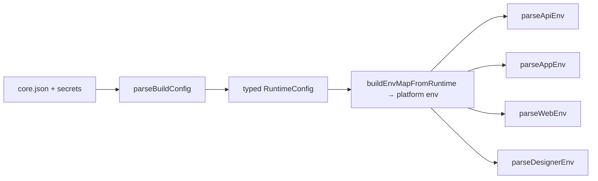

# FAIMS3 Build Configuration (JSON)

The single source of truth for how a FAIMS3 deployment is built and configured is
a **JSON file** (`core.json`). Every target reads its configuration from this one
shared, validated schema in [`@faims3/build-config`](../../../../../library/build-config/README.md):

- the mobile app and web (Vite) builds,
- the Conductor API server,
- the AWS CDK stack,
- local development.

There are **two parse layers**:

1. **JSON (`core.json`)** is the deployment source of truth. `parseBuildConfig`
   validates it into a typed `RuntimeConfig`. An explicit env contract then maps
   that object to each platform's env vars. You should not need to reason about
   individual `VITE_*` or API env-var names when authoring a deployment — set
   the JSON fields and let the contract do the mapping.
2. **Client ENV** is parsed by a dedicated schema per runnable
   (`parseApiEnv` / `parseAppEnv` / `parseWebEnv` / `parseDesignerEnv`). Each
   schema requires that client's endpoints, credentials, and identity. Missing
   required values fail fast; there is no silent `localhost` or
   placeholder-credential fallback at ENV parse time.

## The config chain



- **Layer 1 JSON** (canonical schemas):
  [`library/build-config/src/build-config.ts`](../../../../../library/build-config/src/build-config.ts)
- **Shared enums / defaults / invariants**:
  [`library/build-config/src/shared-schemas.ts`](../../../../../library/build-config/src/shared-schemas.ts)
- **Layer 2 client ENV parsers**:
  [`library/build-config/src/client-env/`](../../../../../library/build-config/src/client-env/)
- **Env mapping** (the transport contract):
  [`library/build-config/src/env-contract.ts`](../../../../../library/build-config/src/env-contract.ts)
- **Concrete examples**:
  [`core.sample.json`](../../../../../library/build-config/config/core.sample.json)
  and
  [`secrets.sample.json`](../../../../../library/build-config/config/secrets.sample.json)

Layer 1 applies shared invariants (name fallbacks, offline-map clamping for OSM,
long-lived-token hint clamping, "no cap" normalisation) in the JSON schema
transform. Layer 2 reuses the same helpers when a client reads those fields
from env.

## Where the files live

| File               | Contents                                                                                                              | Encrypted | Used by                         |
| ------------------ | --------------------------------------------------------------------------------------------------------------------- | --------- | ------------------------------- |
| `core.json`        | The shared non-secret config. All secret **slots are empty** in a committed core.                                     | No        | All platforms                   |
| `secrets.enc.json` | The SOPS-encrypted secret values (one value per secret slot).                                                         | Yes (age) | Mobile CI, Terraform, local dev |
| `aws.json`         | The AWS extension: account/region, hosted zone, certificates, Fargate, and the secret-slot → Secrets-Manager-ARN map. | No        | AWS CDK                         |

How each platform gets its values:

- **SOPS platforms (mobile CI, Terraform, local dev):** decrypt `secrets.enc.json` and
  deep-merge it over `core.json` (`jq -s '.[0] * .[1]' core.json secrets.json`).
- **AWS:** the CDK loads `{ core, aws }` — `core` is `core.json`, `aws` is `aws.json`.
  Secrets resolve from **AWS Secrets Manager** (the `aws` section carries the slot → ARN
  map), which wins over any value in the core. `secrets.enc.json` is not used on AWS.

**Invariant:** a committed `core.json` must keep every declared secret slot empty. This
prevents a locally-convenient real secret from leaking into a path (AWS) where Secrets
Manager is the source of truth.

Per-platform layout:

- Mobile CI / Terraform: `<config-path>/<environment>/core.json` +
  `<config-path>/<environment>/secrets.enc.json` in the private **config** repository
  (`<config-path>` defaults to `configs`, configurable via `CONFIG_REPO_PATH`). The
  **Fastlane/Match** repository is separate (or the same) — see
  [Mobile Deployment Setup Guide](Mobile-Deployment-Setup-Guide.md).
- Local development: `config/dev/core.json` (see [Local development](#local-development)).
- AWS: `config/<environment>/core.json` + `config/<environment>/aws.json`
  (see [Deploying the AWS stack](DeployingAWSStack.md)). The CDK loads the
  folder via `CONFIG_ENV` or `CONFIG_DIR`.

## Protecting the config + Match repositories

The deployment config and the Fastlane Match signing artifacts can live in the
**same** repository or in **separate** ones:

- deployment config + encrypted secrets: `<config-path>/<environment>/core.json` and
  `secrets.enc.json` in the **config** repository (`CONFIG_REPO_SLUG`, path
  `CONFIG_REPO_PATH`, default `configs`)
- Fastlane Match artifacts (certificates and provisioning profiles): the **Match**
  repository (`FASTLANE_REPO_SLUG`, which falls back to the config repo when unset)

Keeping them separate isolates Match's git activity (it tags and commits cert/profile
state) from config edits, so routine config changes can't accidentally damage signing
state — and vice versa. The guardrails below apply to either arrangement (they matter
most when both share one repo):

1. **Keep strict path ownership** — edit only `configs/<environment>/...` for config
   updates; treat Match-managed paths (`certs/`, `profiles/`, and Match metadata files)
   as tool-managed.
2. **Never hand-edit Match artifacts** — use `fastlane match` commands to
   create/renew/revoke certificates or profiles; do not rename, move, or delete files
   under Match-managed paths manually.
3. **Use PR review and branch protection** — require pull requests for changes to this
   repository and at least one reviewer familiar with mobile signing for changes outside
   `configs/`.
4. **Avoid destructive git operations** — do not force-push shared branches, and do not
   squash away the latest known-good Match state without verification.
5. **Keep rollback simple** — tag known-good signing states before certificate/profile
   rotations; if a rotation fails, restore from a known-good commit/tag and rerun
   workflows.
6. **Scope credentials by purpose** — `GIT_AUTHORIZATION` should have least privilege
   (read for CI checkout; write only where rotation/sync workflows require it); keep
   `SOPS_AGE_KEY` limited to environments that must decrypt secrets.

Operational recommendation: use a dedicated maintenance workflow/runbook for
certificate rotations and keep routine config edits separate from signing changes.

## GitHub bootstrap settings

These values stay in GitHub Actions because they are needed before config files can be
read/decrypted (they are _not_ part of `core.json`). Put them on each GitHub
Environment (`dev`, `prod`, `stage`) so environments stay isolated. Workflows
take a dropdown for that Environment. `CONFIG_ENVIRONMENT` is required: it is
the explicit mapping from the GitHub Environment to the config-repo folder.

| GitHub setting                              | Type     | Purpose                                                                                                                     |
| ------------------------------------------- | -------- | --------------------------------------------------------------------------------------------------------------------------- |
| `vars.CONFIG_REPO_SLUG`                     | Variable | Config repository slug (`owner/repo`)                                                                                       |
| `vars.CONFIG_REPO_PATH`                     | Variable | Base path within the config repo where env folders live (default `configs`)                                                 |
| `vars.CONFIG_BRANCH`                        | Variable | Branch in the config repository (default `main`)                                                                            |
| `vars.CONFIG_ENVIRONMENT`                   | Variable | Required. Config-repo folder this GitHub Environment maps to (e.g. `prod`, `nightly`)                                       |
| `secrets.GIT_AUTHORIZATION`                 | Secret   | Token used for private config-repo checkout and Fastlane git auth                                                           |
| `vars.FASTLANE_REPO_SLUG`                   | Variable | Mobile only. Fastlane/Match repository slug (`owner/repo`); unset = same repo as config                                     |
| `secrets.SOPS_AGE_KEY`                      | Secret   | Mobile, and validate-config when `secrets.enc.json` is present. Age private key used by `sops --decrypt`                    |
| `vars.DEPLOY_GA_ROLE_ARN`                   | Variable | CDK only. IAM role the deploy workflow assumes via OIDC. Not used by `validate-config`                                      |
| `vars.SCHEDULED_ANDROID_ENVIRONMENT`        | Variable | Repository-level. GitHub Environment name (`dev`/`prod`/`stage`) for the nightly Android cron. Required for scheduled runs. |
| `vars.SCHEDULED_IOS_TESTFLIGHT_ENVIRONMENT` | Variable | Repository-level. GitHub Environment name for the scheduled iOS TestFlight cron. Required for scheduled runs.               |

## The JSON structure

`core.json` is a set of thematic top-level groups. Each group is a **strict** object:
unknown keys are rejected, so typos and drift fail the parse instead of silently
falling back to a default. Fields with a default are optional; the sample shows a
fully-populated local-dev config. The authoritative field types and defaults are in
`build-config.ts`; the tables below are a reference.

### `endpoints` — service URLs

Concrete URLs. If you also set `domains` (below), the derived endpoint fields
(`apiUrl`, `webUrl`, `appUrl`, `couchdbPublicUrl`, `conductorUrls`) override these.

| Field                 | Type     | Notes                                               |
| --------------------- | -------- | --------------------------------------------------- |
| `apiUrl`              | string   | Conductor API base URL.                             |
| `webUrl`              | string   | Control Centre (web) base URL.                      |
| `appUrl`              | string   | Mobile app (PWA) base URL.                          |
| `couchdbInternalUrl`  | string   | CouchDB URL reachable from the API.                 |
| `couchdbPublicUrl`    | string   | CouchDB URL the app syncs to.                       |
| `androidAppPublicUrl` | string   | Google Play store listing URL.                      |
| `iosAppPublicUrl`     | string   | Apple App Store listing URL.                        |
| `conductorUrls`       | string[] | Conductor URLs the app may contact (CSV in env).    |
| `redirectWhitelist`   | string[] | Allowed redirect origins (the app adds `appId://`). |

### `domains` — derived endpoints (optional)

Instead of storing concrete URLs, model the deployment's domain structure and **derive**
the endpoints. When present, it overrides the `endpoints` fields above, so the app
build and the CDK can never disagree about a URL.

| Field           | Type   | Notes                                                                                                                   |
| --------------- | ------ | ----------------------------------------------------------------------------------------------------------------------- |
| `base`          | string | Base domain, e.g. `faims.example.com`.                                                                                  |
| `protocol`      | string | `https` (default) or `http`.                                                                                            |
| `services`      | object | Per-service subdomain names: `conductor`, `couch`, `web`, `app`, `docs`.                                                |
| `localOverride` | object | **Optional.** Literal `host:port` overrides for local/dev; when a key is present the host is used verbatim with `http`. |

A production config omits `localOverride`; a local/dev config sets it (this presence is
the "local mode" switch — there is no separate `environment` flag). Example:

```jsonc
"domains": {
  "base": "faims.example.com",
  "protocol": "https",
  "services": { "conductor": "api", "couch": "couchdb", "web": "dashboard", "app": "app", "docs": "docs" },
  "localOverride": { "conductor": "localhost:8080", "couch": "localhost:5984", "web": "localhost:3001", "app": "localhost:3000" }
}
```

### `branding` — naming and identity

| Field                      | Type   | Default                    | Notes                                                  |
| -------------------------- | ------ | -------------------------- | ------------------------------------------------------ |
| `appName`                  | string | `FAIMS`                    | App name (store listings, headings).                   |
| `appShortName`             | string | falls back to `appName`    | Short name; falls back to `appName`.                   |
| `headingAppName`           | string | falls back to `appName`    | Banner heading; falls back to `appName`.               |
| `theme`                    | string | `default`                  | `default` \| `fieldmark` \| `bssTheme`.                |
| `websiteTitle`             | string | `Control Centre`           | Control Centre document title.                         |
| `clusterAdminGroupName`    | string | `cluster-admin`            | Couch/directory cluster-admin group name in app build. |
| `conductorInstanceName`    | string | `Development FAIMS Server` | Shown on the login/conductor listing.                  |
| `conductorDescription`     | string | `FAIMS Conductor Server`   |                                                        |
| `conductorShortCodePrefix` | string | `FAIMS`                    | Invite-code prefix (`{prefix}-{code}`).                |

### `support` — contacts and links

| Field              | Type   | Notes                               |
| ------------------ | ------ | ----------------------------------- |
| `supportEmail`     | string | Support contact.                    |
| `privacyPolicyUrl` | string | Privacy policy link.                |
| `appContactUrl`    | string | Contact page; empty hides the link. |
| `docsUrl`          | string | Documentation site URL (optional).  |

### `notebookAndRecordUX` — notebook/record presentation

| Field                     | Type    | Default   | Notes                                         |
| ------------------------- | ------- | --------- | --------------------------------------------- |
| `notebookName`            | string  | `project` | Display name for a notebook.                  |
| `notebookListType`        | string  | `tabs`    | `tabs` \| `headings`.                         |
| `navigation`              | string  | `none`    | `none` \| `breadcrumbs`.                      |
| `showStatusTab`           | boolean | `true`    | Show the record "Status" tab.                 |
| `showNewNotebook`         | boolean | `true`    | Show the "New notebook" action in the app.    |
| `showRecordSummaryCounts` | boolean | `true`    | Show record summary counts on notebook cards. |

### `maps` — tiles and address autosuggest

| Field                    | Type     | Default  | Notes                                                 |
| ------------------------ | -------- | -------- | ----------------------------------------------------- |
| `mapSource`              | string   | `osm`    | `osm` \| `maptiler` \| `''` (blank).                  |
| `mapSourceKey`           | string   | —        | API key for the tile provider. **Public/client key.** |
| `satelliteSource`        | string   | —        | Optional satellite layer source.                      |
| `mapStyle`               | string   | `basic`  | Tile style.                                           |
| `offlineMaps`            | boolean  | `true`   | Enable offline map downloads (clamped off for OSM).   |
| `autosuggestSource`      | string   | `none`   | `none` \| `mapbox` \| `maptiler`.                     |
| `autosuggestMapboxKey`   | string   | —        | Required when `autosuggestSource` is `mapbox`.        |
| `autosuggestMapTilerKey` | string   | —        | Optional when `autosuggestSource` is `maptiler`.      |
| `mapboxAddressCountry`   | string[] | `["AU"]` | ISO 3166-1 alpha-2 codes (CSV in env).                |
| `maptilerAddressCountry` | string[] | `["AU"]` | ISO 3166-1 alpha-2 codes (CSV in env).                |

Any key in `maps` is a **public/client** key — it is baked into the front-end bundle,
so only use keys suitable for public consumption.

### `sync` — offline sync behaviour

| Field                         | Type    | Default | Notes                                         |
| ----------------------------- | ------- | ------- | --------------------------------------------- |
| `syncPushOnlyRecordThreshold` | number  | `500`   | Records above which a sync is push-only.      |
| `forceRemoteDeletion`         | string  | `never` | `never` \| `allow` — wipe local data on sync. |
| `deleteOnDeactivation`        | boolean | `false` | Wipe local Pouch data on manual deactivation. |

### `attachments`

| Field                        | Type   | Default | Notes                               |
| ---------------------------- | ------ | ------- | ----------------------------------- |
| `attachmentServiceType`      | string | `COUCH` | Where attachments are stored.       |
| `attachmentDocumentIdPrefix` | string | `''`    | Prefix for attachment document IDs. |

### `attachmentStorage` — map-layer object storage

| Field             | Type    | Default            | Notes                                                                   |
| ----------------- | ------- | ------------------ | ----------------------------------------------------------------------- |
| `serviceType`     | string  | `S3`               | `S3` \| `MOCK`.                                                         |
| `bucket`          | string  | `faims-map-assets` | S3 bucket name (overridden on AWS by the CDK-created bucket).           |
| `prefix`          | string  | `map-assets`       | Key prefix inside the bucket.                                           |
| `region`          | string  | `us-east-1`        | AWS region or RustFS dummy region (overridden on AWS by stack region).  |
| `endpoint`        | string  | —                  | Custom S3 endpoint (e.g. `http://localhost:9000` for RustFS).           |
| `publicEndpoint`  | string  | —                  | Host-visible signing endpoint when `endpoint` is internal-only.         |
| `forcePathStyle`  | boolean | —                  | Path-style S3 URLs (defaults to `true` when `endpoint` is set).         |
| `accessKeyId`     | string  | —                  | **Secret slot** — static S3 access key (omit on AWS ECS for task role). |
| `secretAccessKey` | string  | —                  | **Secret slot** — static S3 secret key (omit on AWS ECS for task role). |

### `spatialCapacity` — spatial worker pool & GDAL tuning

| Field                  | Type                | Default          | Notes                                                                |
| ---------------------- | ------------------- | ---------------- | -------------------------------------------------------------------- |
| `provider`             | string              | `FIXED`          | `FIXED` \| `ECS` \| `MOCK`.                                          |
| `maxCapacity`          | number              | `4`              | Max workers the capacity manager will ask for at once.               |
| `scaleThresholds`      | number[]            | `[3, 8, 16, 32]` | Strictly-increasing queue depths that add a worker.                  |
| `reconcileMs`          | number              | `15000`          | Queue reconciliation interval (ms).                                  |
| `starvationMs`         | number              | `300000`         | Age of oldest unclaimed job before asking for an extra worker (`0`). |
| `scaleInCooldownMs`    | number              | —                | Cooldown between staleness scale-ups (defaults to `2 * starvation`). |
| `fixedReplicas`        | number              | `1`              | Replica count reported by the `FIXED` provider.                      |
| `idleExitMs`           | number              | `60000`          | Worker idle timeout before exit (`0` never exits).                   |
| `pollMs`               | number              | `5000`           | Delay between empty worker polls (ms).                               |
| `gdalNumThreads`       | `"ALL_CPUS"` \| int | `"ALL_CPUS"`     | GDAL worker thread count.                                            |
| `gdalCacheMaxMb`       | number              | `256`            | GDAL raster block cache (MB).                                        |
| `gdalWarpMemoryMb`     | number              | `256`            | `gdalwarp -wm` working buffer (MB).                                  |
| `gdalWarpMulti`        | boolean             | `true`           | `gdalwarp -multi` overlap I/O with compute.                          |
| `tippecanoeMaxThreads` | number              | —                | Optional cap on tippecanoe threads.                                  |

### `migration`

| Field                           | Type    | Default   | Notes                                                                                                      |
| ------------------------------- | ------- | --------- | ---------------------------------------------------------------------------------------------------------- |
| `migrateOldDatabases`           | boolean | `false`   | Migrate legacy databases.                                                                                  |
| `disableMigrateOnStartup`       | boolean | `false`   | Skip API-boot migrate.                                                                                     |
| `startupMigrationLockEnabled`   | boolean | omit      | Couch-mediated lock. Local API treats omit as off; AWS CDK treats omit as on and honours explicit `false`. |
| `startupMigrationLockTimeoutMs` | number  | `1800000` | Age before a stuck `running` lock is stolen.                                                               |

Invariant: the lock cannot be enabled while `disableMigrateOnStartup` is `true`.

### `auth`

| Field                     | Type    | Default     | Notes                                      |
| ------------------------- | ------- | ----------- | ------------------------------------------ |
| `profileName`             | string  | `local-dev` | Auth profile.                              |
| `keyFilePath`             | string  | `.`         | Path to the local signing keypair.         |
| `keySource`               | string  | `FILE`      | `FILE` \| `ENV` \| `AWS_SM`.               |
| `awsSecretKeyArn`         | string  | —           | Required when `keySource` is `AWS_SM`.     |
| `cookieSecret`            | string  | —           | **Secret slot** (empty in committed core). |
| `disableLocalLogin`       | boolean | `false`     | Disable the local (non-SSO) login.         |
| `provisionSsoUsersPolicy` | string  | `reject`    | What to do with an unknown SSO user.       |

### `authProviders`

A map of provider id → provider config. Each provider's `type` selects its required
fields; the credential fields (`clientID`, `clientSecret`, `privateKey`, `publicKey`,
`idpPublicKey`) are **secret slots** — empty in a committed core, filled by SOPS or
resolved from Secrets Manager on AWS. Non-secret fields (`displayName`, `helperText`,
`scope`, `callbackMethods`) live in the core. See
`auth-provider-config.ts` for the per-type shapes.

### `authTokens`

| Field                               | Type                    | Default              | Notes                                                                             |
| ----------------------------------- | ----------------------- | -------------------- | --------------------------------------------------------------------------------- |
| `tokenRefreshIntervalMs`            | number                  | `15000`              | Token refresh interval.                                                           |
| `tokenRefreshWindowMs`              | number                  | `60000`              | Refresh window.                                                                   |
| `loginBannerGraceMs`                | number                  | `10000`              | Grace period before the login banner.                                             |
| `ignoreTokenExp`                    | boolean                 | `false`              | Ignore token expiry (dev/testing).                                                |
| `longLivedTokenDurationHints`       | number[]                | `[1,5,10,30,90,365]` | Offered long-lived token durations (clamped to ≤ `maximumLongLivedDurationDays`). |
| `refreshTokenExpiryMinutes`         | number                  | `2880`               | Refresh-token lifetime.                                                           |
| `accessTokenExpiryMinutes`          | number                  | `5`                  | Access-token lifetime.                                                            |
| `impersonationSessionExpiryMinutes` | number                  | `60`                 | Impersonation session lifetime.                                                   |
| `emailCodeExpiryMinutes`            | number                  | `30`                 | Email verification code lifetime.                                                 |
| `maximumLongLivedDurationDays`      | number \| `"unlimited"` | `90`                 | Max long-lived token duration (`"unlimited"` disables the cap).                   |

### `limits`

| Field                        | Type    | Default      | Notes                                  |
| ---------------------------- | ------- | ------------ | -------------------------------------- |
| `rateLimiterWindowMs`        | number  | `600000`     | Express HTTP IP-limiter window.        |
| `rateLimiterPerWindow`       | number  | `1000`       | Requests allowed per window.           |
| `rateLimiterEnabled`         | boolean | `true`       | Enable the HTTP IP limiter.            |
| `exportRateLimiterEnabled`   | boolean | `true`       | Dedicated notebook-export limiter.     |
| `exportRateLimiterWindowMs`  | number  | `600000`     | Export-limiter window.                 |
| `exportRateLimiterPerWindow` | number  | `20`         | Export requests allowed per window.    |
| `attemptLimiterEnabled`      | boolean | `true`       | Email-code/verification attempt limit. |
| `jsonBodyLimit`              | string  | `25mb`       | JSON request body limit.               |
| `urlencodedBodyLimit`        | string  | `1mb`        | URL-encoded request body limit.        |
| `restoreUploadMaxBytes`      | number  | `1073741824` | Max restore-upload size.               |
| `downloadCookieSameSite`     | string  | `lax`        | Download-cookie SameSite.              |
| `recordsHydratedPageLimit`   | number  | `150`        | Hydrated-record page limit.            |

### `email`

| Field                    | Type    | Default                     | Notes                                                                                             |
| ------------------------ | ------- | --------------------------- | ------------------------------------------------------------------------------------------------- |
| `emailServiceType`       | string  | `MOCK`                      | `MOCK` \| `SMTP`.                                                                                 |
| `emailFromAddress`       | string  | `notifications@example.com` |                                                                                                   |
| `emailFromName`          | string  | `FAIMS Notification`        |                                                                                                   |
| `emailReplyTo`           | string  | `support@example.com`       |                                                                                                   |
| `smtpHost`               | string  | —                           | **Secret-adjacent** (host). Optional in JSON; required in API ENV when `EMAIL_SERVICE_TYPE=SMTP`. |
| `smtpPort`               | number  | `587`                       |                                                                                                   |
| `smtpSecure`             | boolean | `false`                     | Implicit TLS. Unset means STARTTLS (typical port 587).                                            |
| `smtpUser`               | string  | —                           | **Secret slot.**                                                                                  |
| `smtpPassword`           | string  | —                           | **Secret slot.**                                                                                  |
| `smtpCacheExpirySeconds` | number  | `300`                       | SMTP connection-cache TTL.                                                                        |
| `testEmailAddress`       | string  | —                           | Optional destination for admin test emails (`POST /api/admin/test-email`).                        |

### `observability`

| Field                   | Type    | Default | Notes                                                                          |
| ----------------------- | ------- | ------- | ------------------------------------------------------------------------------ |
| `bugsnagApiKey`         | string  | `''`    | **Secret slot.** Client key.                                                   |
| `commitVersion`         | string  | —       | Build commit; `output of \`git rev-parse HEAD\`` is resolved at generate time. |
| `memoryMonitorEnabled`  | boolean | `false` | Start the 1 Hz API stdout memory sampler for leak hunts.                       |
| `requestLoggingEnabled` | boolean | `true`  | Write Morgan combined-format HTTP access lines on the API server.              |

### `teamAndRolePolicy`

| Field               | Type     | Default | Notes                                      |
| ------------------- | -------- | ------- | ------------------------------------------ |
| `excludedTeamRoles` | string[] | `[]`    | Team roles hidden from the Control Centre. |

### `webDesignerLimits`

| Field                   | Type    | Default | Notes                               |
| ----------------------- | ------- | ------- | ----------------------------------- |
| `maxDesignFileSizeMb`   | number  | `10`    | Max design-file upload size.        |
| `templateProtections`   | boolean | `false` | Enforce template protections.       |
| `enablePlansInDesigner` | boolean | `true`  | Allow adding plans in the designer. |

### `android` — Android build

| Field                         | Type   | Notes                                                |
| ----------------------------- | ------ | ---------------------------------------------------- |
| `appId`                       | string | Package id / app id.                                 |
| `releaseStatus`               | string | `draft` \| `production` (Fastlane track).            |
| `keystoreFileBase64`          | string | **Secret slot** — keystore, base64.                  |
| `serviceAccountKeyJsonBase64` | string | **Secret slot** — Play service-account JSON, base64. |
| `keystorePassword`            | string | **Secret slot.**                                     |
| `keyAlias`                    | string | **Secret slot.**                                     |
| `keyPassword`                 | string | **Secret slot.**                                     |

### `ios` — iOS build

| Field                                           | Type   | Notes                                     |
| ----------------------------------------------- | ------ | ----------------------------------------- |
| `bundleIdentifier`                              | string | Falls back to `android.appId`.            |
| `appStoreConnectTeamId`                         | string | ASC team id.                              |
| `developerPortalTeamId`                         | string | Developer-portal team id.                 |
| `appleId`                                       | string | **Secret slot.**                          |
| `appleApplicationSpecificPassword`              | string | **Secret slot.**                          |
| `matchPassword`                                 | string | **Secret slot.**                          |
| `matchGitUrl`                                   | string | Match repo URL (or set in CI).            |
| `gitAuthorization`                              | string | **Secret slot** (optional in JSON).       |
| `provisioningProfileSpecifier`                  | string | Provisioning profile (or in secrets).     |
| `appleKeyId` / `appleIndividualKeyId`           | string | **Secret slot.** Individual-key fallback. |
| `appleIssuerId`                                 | string | **Secret slot** (team-key flows).         |
| `appleKeyContent` / `appleIndividualKeyContent` | string | **Secret slot.** Individual-key fallback. |

Team-key flows use `appleKeyId` + `appleIssuerId` + `appleKeyContent`; individual-key
flows use `appleKeyId` + `appleKeyContent` only.

### `couchdb`

| Field          | Type   | Default | Notes                                                   |
| -------------- | ------ | ------- | ------------------------------------------------------- |
| `user`         | string | `admin` |                                                         |
| `password`     | string | —       | **Secret slot.** Optional in JSON; required in API ENV. |
| `externalPort` | number | `5984`  |                                                         |

### `conductor`

Port topology for the conductor (API server). On AWS the CDK pins both to
the deployed values (external `443` via the ALB, internal `8000`) regardless
of what core says.

| Field          | Type   | Default | Notes                       |
| -------------- | ------ | ------- | --------------------------- |
| `externalPort` | number | `8080`  | Published surface port.     |
| `internalPort` | number | `8080`  | Port the API process binds. |

### `dev` and `pouchdb` — development / PouchDB tuning

| Field                | Type    | Default | Notes                        |
| -------------------- | ------- | ------- | ---------------------------- |
| `developerMode`      | boolean | `false` | Developer mode.              |
| `debugApp`           | boolean | `false` | App debug build.             |
| `debugPouchDb`       | boolean | `false` | PouchDB debug build.         |
| `showWipe`           | boolean | `true`  | Show the "wipe data" option. |
| `showPouchDbBrowser` | boolean | `true`  | Show the PouchDB browser.    |
| `pouchBatchSize`     | number  | `10`    | PouchDB batch size.          |
| `pouchBatchesLimit`  | number  | `10`    | PouchDB batches limit.       |

## Secret slots

There is **no** untyped secrets passthrough. A secret is an explicit named field marked
as a **secret slot** (the empty slots in a committed `core.json`). Platform-level
secrets that are never in the JSON — `PRIVATE_SIGNING_KEY`, `PUBLIC_SIGNING_KEY`,
`SOPS_AGE_KEY`, `GIT_AUTHORIZATION` — stay injected by the deployment platform / CI.

## Generating env from the JSON

The generator turns `core.json` into a platform env file:

```bash
# apps half (mobile app + Control Centre web builds):
pnpm --filter=@faims3/build-config run generate -- --config core.json --platform apps --out .env

# api half (Conductor server):
pnpm --filter=@faims3/build-config run generate -- --config core.json --platform api --out api/.env
```

`--platform android` and `--platform ios` are aliases for `apps` (the mobile CI
workflows pass those; the two mobile builds share one generated env).

## Local development

For local development the config lives at `config/dev/core.json` (git-ignored) and the
`scripts/generateDevEnv.sh` helper generates all four env files from it:

```bash
scripts/generateDevEnv.sh   # -> api/.env, app/.env, web/.env, docs/.env
```

Set `domains.localOverride` (or concrete `endpoints`) to the `localhost` hosts so the
generated env points at the local services. The `config/` directory is git-ignored so
local values never get committed.

## Adding a new configuration option

Follow the sequence in the
[`@faims3/build-config` README](../../../../../library/build-config/README.md#how-to-add-a-new-configuration-option):
add the field to the canonical JSON schema, extend the runtime model, add the
env-contract mapping, add the field to the relevant client ENV schema, and add
positive/negative tests. Then run `pnpm --filter=@faims3/build-config test`.
