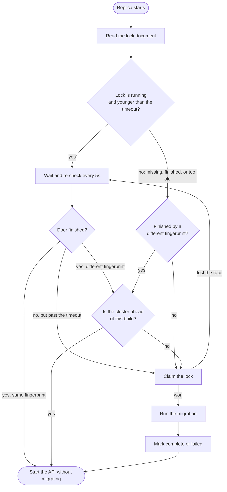

# How database migrations run

This page explains how FAIMS3 brings its CouchDB databases up to date: what a migration run does, when it runs, how clustered API replicas avoid treading on each other, and what to do when something goes wrong.

It is written for operators and for developers who need to understand the running system. Related pages:

- [Couch migrations](./CouchMigrations.md) — how to **write** a new database migration step.
- [Notebook migrations](./NotebookMigrations.md) — how notebook designs (`uiSpec.schemaVersion`) are versioned and migrated.
- [Metadata migration guide](./MetadataMigrationGuide.md) — a one-off upgrade guide for the v1.6.0 metadata overhaul.

## The short version

- Every time the API (Conductor) starts, it migrates the databases **before** it starts serving the full API. You normally do not need to run anything by hand.
- Migrations only move forward. Running them twice is safe: anything already up to date is skipped.
- In a cluster (several API replicas), a **lock** document in CouchDB makes sure only one replica does the work. The others wait, then start once it is done.
- A replica running **older** code will not migrate over a cluster that **newer** code has already migrated.
- Startup never gets stuck on a failed migration. Failures are logged and recorded, and the API still starts.
- `pnpm run debug-migration-lock` (from `api/`) shows the current state and has commands to fix a stuck lock or a bad record.

## What gets migrated

The server keeps three kinds of thing up to date.

| What                                                        | Example                                                                                                          | Versioned by                                                                                                                                                        |
| ----------------------------------------------------------- | ---------------------------------------------------------------------------------------------------------------- | ------------------------------------------------------------------------------------------------------------------------------------------------------------------- |
| **Database setup**: design documents and security documents | Add a view to `projects`, tighten the `validate_doc_update` rule on data databases, change who can read `people` | Separate integer versions per database type for design and for security, plus a hash of the contents, stored in a `db-setup` document in the `migrations` database. |
| **Couch databases** (document structure)                    | Rename a field on every user document in `people`                                                                | An integer version per database, stored in the `migrations` database. Targets live in `DB_TARGET_VERSIONS`.                                                         |
| **Notebook designs** (`uiSpecification`)                    | Rewrite an old notebook design stored on a project to the current format                                         | `uiSpec.schemaVersion` on each project and template, compared to this build's `CURRENT_NOTEBOOK_UI_SCHEMA_VERSION`.                                                 |

The mobile app and the web designer also migrate notebook designs in memory when they load them. That is covered in [Notebook migrations](./NotebookMigrations.md), not here.

### Design and security documents

Each database has some setup documents that come from the code rather than from users. They are defined by the `init*DB` functions in `library/data-model/src/data_storage/*/init.ts`:

- **Design documents** (`_design/…`). These hold the database's **views and indexes** (for example, the project listing), and sometimes a **`validate_doc_update`** function. CouchDB runs that function on every write and rejects writes that break its rules.
- **The security document** (`_security`). This says which users and roles can read or write the database.
- **A default document**, for some databases. For example, the `directory` database holds a document that identifies this Conductor.

Every migration run (step 1 below) decides what to do from the `db-setup` record for that database. Design and security are decided **separately**. The names in brackets are the `SetupAction` values used in code and logs:

- **Recorded version higher than this build** (`ahead`): leave the stored documents alone, log an error, and report it to Bugsnag (one event per run, not per database). Do not downgrade.
- **Recorded version equal, and the stored hash matches this build** (`up_to_date`): skip all reads and writes of that part. The record is trusted.
- **Recorded version equal, but the hash does not match** (`patch`): log a warning and push this build's documents. Use this for a quick fix you do not want to promote as a new version.
- **Recorded version lower, or no record yet** (`upgrade`): push this build's documents and update the record. This is a normal migrate.

The default document (for example the directory identity document) is **not** versioned. It still uses the old "write if missing, overwrite if `force` and the content differs" behaviour.

Hand edits made directly in Couch are not repaired on the happy path. `debug-migration-lock verify-setup` shows the drift; `reset-setup` clears the record so the next run pushes.

Changing a view also makes CouchDB rebuild that index. On a large database, the first query that uses the view can be slow while the rebuild runs.

#### How to change a design or security document

1. Edit the `init*DB` / design / security module.
2. For a real change, bump `DB_SETUP_VERSIONS` for that type's `design` or `security` number in `library/data-model/src/data_storage/migrations/dbSetup.ts`. For a same-version patch, leave the number and accept that mixed rollouts with different hashes will rewrite each other's docs until the rollout finishes.
3. Update the pinned hashes in `library/data-model/tests/dbSetupHashes.test.ts` (the test fails until you do).
4. Run the data-model tests.

### Which databases

These global databases each have one version record: `auth`, `directory`, `invites`, `people`, `projects`, `templates`, `teams`, `mapassets` and `tombstone`. Each survey (project) also has its own `data-{projectId}` database, and each of those has its own version record.

The `migrations` database holds the version records, setup records, lock and notebook marker (see [The migrations database](#the-migrations-database)). It has its own `db-setup` record (design and security versions) like every other database.

## What one migration run does

A full run happens in this order. API startup and the command-line `migrate` script both do all of it; the command line can skip steps 5–6 with `--skip-notebooks` (see [Command line](#from-the-command-line)).

1. **Initialise.** Make sure every global database exists (the `migrations` database first), and bring its [design and security documents](#design-and-security-documents) in line with the running code using the rules above. Then do the same for every project's data database. Creating a survey also writes that data database's `db-setup` record, at the same time as its version record.
2. **Push the JWT signing key** to CouchDB's configuration, so CouchDB accepts tokens signed by this API. (The CLI only does this with `migrate-with-keys`.)
3. **Migrate the global databases**, one at a time, in a fixed order. They run one at a time because a step for one database may read another.
4. **Migrate every project's data database**, four at a time. Then make sure the admin user exists.
5. **Walk the notebook designs** (`validateDatabases`). For every project and template, including archived ones, rewrite the stored design if its `schemaVersion` is older than this build's. Designs that are current or **newer** are left alone.
6. **Record the notebook marker.** If the walk completed, raise the `notebook-ui-schema-state` document to this build's `CURRENT_NOTEBOOK_UI_SCHEMA_VERSION` (it is never lowered). This records that a build at this version has run the walk. See [Why notebooks use a marker](#why-notebooks-use-a-marker).

### How a single database is migrated

For each database, the migration service:

1. Reads its version record. If there is none, it creates one at the type's **default version** (the assumed starting point for old, unregistered databases). New project data databases are registered straight at the current target version when the survey is created, so they skip old steps.
2. Compares the recorded version to the **target version** for this build. If they are equal, it skips the database.
3. Runs each step in order (v3→v4, then v4→v5, …). Each step reads every document in batches of 100 and either leaves it, updates it or deletes it.
4. If a step reports problems, it stops there. The version record keeps the last version that fully succeeded and is marked `not-healthy`, so the next run tries again from that point.
5. Appends an entry to the record's migration log (from, to, when, who, issues).

One bad database never stops the others. If the recorded version is **higher** than this build's target (newer code was here), the service refuses to downgrade: it logs an error and marks that record `not-healthy`.

## When migrations run

### On API startup

Each API process starts in stages:

1. Load and check its configuration.
2. Start listening, serving only `GET /up`. Load balancer health checks use this, so a slow migration does not get the container killed.
3. Run the startup migrations (`runStartupMigrations` in `api/src/couchdb/startupMigrations.ts`).
4. Attach the full API, including `GET /ready`.

Step 3 always finishes, whether or not the migration succeeded. If it failed, the error is logged and the API starts anyway. This matches how FAIMS3 has always behaved: a partially migrated system is usually better than an API that will not start.

### From the command line

From `api/`, with `.env` pointing at the target CouchDB:

```bash
pnpm run migrate                    # everything startup does, forced; does not push the JWT key
pnpm run migrate-with-keys          # same, and push the JWT key
pnpm run migrate --skip-notebooks   # skip the notebook design walk and marker
```

In a Docker setup, run it inside the container so it uses the container's CouchDB URL:

```bash
docker compose exec conductor pnpm run migrate
```

The rule of thumb: the command line does everything startup does, but forcefully. The differences:

|                            | API startup                     | `pnpm run migrate` / `migrate-with-keys`                 |
| -------------------------- | ------------------------------- | -------------------------------------------------------- |
| Takes the startup lock     | Yes, when the lock is enabled   | **No**                                                   |
| Cluster-ahead check        | Yes, after a foreign settlement | **No**                                                   |
| Notebook design walk       | Yes                             | Yes, unless `--skip-notebooks`                           |
| Writes the notebook marker | Yes, if the walk completed      | Yes, if the walk completed (not with `--skip-notebooks`) |
| Pushes the JWT key         | Yes                             | Only `migrate-with-keys`                                 |
| Design / security docs     | Only when `db-setup` says so    | Always pushed, and `db-setup` rewritten                  |
| On failure                 | Logs, then starts the API       | Exits with code 1 (including a failed notebook walk)     |

The command line pushes every database's design and security documents even when its `db-setup` record says they are up to date. It then rewrites the record with this build's version and hash, and logs the result as `[db-setup] forced`. Use it to repair a database whose live documents drifted from the record, for example after the database was recreated. A record whose version is ahead of this build is still left alone; clear it with `reset-setup` first if you mean to push over it. Couch version records and migration statuses work the same as at startup. The notebook walk never downgrades a design that is current or newer, and the marker is only ever raised, so running an older build's command line cannot undo a newer build's notebook work.

Because the command line does not take the lock, **do not run it against a live cluster that is also starting up**: both would write design documents and notebook designs at once. Scale the API down first, or just let startup do the work. The command line is useful for a controlled run before replicas start, to push keys, or to retry after a failure. Use `--skip-notebooks` on large deployments when you only need to repair databases or push keys.

## Settings

| Environment variable                | Default                  | What it does                                                                                                               |
| ----------------------------------- | ------------------------ | -------------------------------------------------------------------------------------------------------------------------- |
| `DISABLE_MIGRATE_ON_STARTUP`        | `false` (migrate **on**) | `true` skips startup migration entirely: no migrate, no lock, no notebook walk. Use only when you migrate another way.     |
| `STARTUP_MIGRATION_LOCK_ENABLED`    | `false` (lock **off**)   | `true` makes replicas use the [startup lock](#the-startup-lock-clustered-deployments). Ignored when migration is disabled. |
| `STARTUP_MIGRATION_LOCK_TIMEOUT_MS` | `1800000` (30 minutes)   | How long a `running` lock can be held before another replica [takes it over](#timeouts-and-takeovers).                     |

**Recommended setups:**

- **Local development (`pnpm run dev`):** migrate on, lock off (the defaults). If the lock were on, killing the dev server mid-migration would leave a `running` lock, and the next start would wait up to 30 minutes.
- **Production with more than one API replica:** migrate on, lock **on**. Without the lock, every replica migrates at the same time.
- **Single-replica production:** the lock is optional but harmless. Turn it on if you might scale up later.

**AWS CDK:** these come from `core.migration` in the deployment config. `startupMigrationLockEnabled` defaults to **on** (ECS is clustered); set it to `false` only for a single-task or debug stack. `disableMigrateOnStartup: true` forces the lock off, and setting `startupMigrationLockEnabled: true` with it is a config error. `startupMigrationLockTimeoutMs` sets the timeout. See `infrastructure/aws-cdk/README.md`.

## The migrations database

The `migrations` database is where migration state lives. It holds three kinds of document.

### Version records (one per database)

```json
{
  "kind": "db-version",
  "dbType": "PEOPLE",
  "dbName": "people",
  "version": 3,
  "status": "healthy",
  "migrationLog": [
    {
      "from": 2,
      "to": 3,
      "status": "success",
      "launchedBy": "system",
      "startedAtTimestampMs": 1763520000000,
      "completedAtTimestampMs": 1763520004000,
      "notes": "Migrating from v2 to v3\n- …",
      "issues": []
    }
  ]
}
```

`version` is the last version that fully succeeded. `status` is `not-healthy` if the last attempt had problems. New records set `kind` to `db-version`. Older records have no `kind`; the views still treat them as version records. Other migrations-DB documents (lock, notebook marker, `db-setup`) have a different `kind`, so they are never indexed as version records.

### Database setup (`db-setup::<TYPE>::<dbName>`)

One document per database, including the `migrations` database itself. Design and security are stored separately:

```json
{
  "_id": "db-setup::PEOPLE::people",
  "kind": "db-setup",
  "dbType": "PEOPLE",
  "dbName": "people",
  "design": {
    "version": 1,
    "hash": "3f9a…",
    "updatedAtMs": 1763520000000
  },
  "security": {
    "version": 1,
    "hash": "8c21…",
    "updatedAtMs": 1763520000000
  }
}
```

The hash is a SHA-256 of the canonical JSON of that part (design documents sorted by `_id`, with `_rev` dropped). Data-database security documents include the project id, so their hash is per database; their version is per type. Creating a survey writes this document as well as the version record; deleting a survey removes both.

### The startup lock (`startup-migration-lock`)

One document that coordinates replicas. It records who holds it (`holderId`, as `hostname:pid:random`), its `status` (`running`, `complete` or `failed`), when the attempt started, an attempt counter, the error if it failed, the **fingerprint** and API version of the holder, and a history of the last 10 attempts.

### The notebook marker (`notebook-ui-schema-state`)

```json
{
  "_id": "notebook-ui-schema-state",
  "kind": "notebook-ui-schema",
  "schemaVersion": "1.0.1",
  "updatedAtMs": 1763520010000,
  "fingerprint": "3f9a1c0b7d2e",
  "apiVersion": "1.11.0",
  "writerId": "ip-10-0-1-23:1:9b2f61aa"
}
```

It means "a build targeting notebook schema `1.0.1` has run the notebook walk". It does **not** mean every notebook is at that version: the walk carries on past individual notebooks that fail. Startup and the command-line `migrate` write it after a walk that completed (not with `--skip-notebooks`), and only upwards. The fingerprint, API version and writer are there to help with debugging.

Version-record views select by `kind` (`db-version`, or missing for old records) plus the version-record fields. The lock, marker and `db-setup` documents have a different `kind`, so the migration service never mistakes them for version records.

## The startup lock (clustered deployments)

### Why it exists

When a new release rolls out, several API replicas start at about the same time. Without coordination they would all migrate the same databases at once. That wastes work, causes write conflicts, and can leave version records in a confusing state.

The lock is a single CouchDB document. CouchDB only accepts a write if it is based on the latest revision, so when two replicas try to claim the lock at the same moment, exactly one succeeds.

### Roles

- **Doer:** the replica that claimed the lock. It runs the migration, then marks the lock `complete` or `failed`.
- **Waiter:** any replica that found the lock already `running`. It checks again every 5 seconds until the doer finishes, then starts its API **without** migrating.

A `failed` result still counts as finished. Waiters start their API either way, in line with "startup never gets stuck".

### Step by step



A few things to notice:

- A replica that starts **after** the lock is already `complete` claims it again and re-runs the migration. That is cheap (everything is skipped when up to date), and it means a later restart always re-checks.
- Waiters that joined a live attempt do not re-run it. They wait for it to finish.
- A replica never takes over a live (`running`, not timed out) lock, even if it holds a different fingerprint.

### Timeouts and takeovers

The lock has no heartbeat. Its age is measured from when the attempt **started**. Once a `running` lock is older than `STARTUP_MIGRATION_LOCK_TIMEOUT_MS` (30 minutes by default), a waiter takes it over and runs the migration itself. Only one waiter wins that takeover.

Some consequences:

- The timeout is a takeover, not "give up and start anyway". Some replica always ends up doing the migration.
- A migration that is just slow is treated the same as one that crashed. The original doer is not stopped. If it is still working, both run until it finishes. Migrations are safe to run twice, so this only wastes effort.
- The original doer can no longer write its result onto the lock once it has been taken over.

If a migration genuinely needs more than 30 minutes, raise the timeout.

### Fingerprints: which code finished the migration?

A replica should only accept "migration finished" from a replica running the **same** migration code. Otherwise, during a rolling deploy, a replica on the new release could see an old replica's `complete` and start its API without running the new migrations.

So each replica computes a short **fingerprint** of what its migration is meant to produce, and stores it on the lock when it claims it. The fingerprint is a 12-character hash of:

- every database's target version,
- the target notebook schema version,
- the design and security documents each database should have,
- each database type's design/security setup versions and hashes,
- the public JWT signing key.

It does not include the API version number, so two builds with identical migrations share a fingerprint even if their version numbers differ.

A waiter only accepts `complete` or `failed` when the lock's fingerprint matches its own. If it does not match, the waiter treats the lock as "finished by someone else", and goes through the cluster-ahead check below.

### Cluster ahead: stopping old code from undoing new work

During a rolling deploy or a rollback, an old replica can start after a new one has finished migrating. If the old replica claimed the lock, it would:

- overwrite the new design documents with its older ones (step 1 always overwrites),
- try to "migrate" databases that are already past its target, which marks their records `not-healthy`, and
- possibly mark the lock `failed` over the new release's successful result.

To prevent that, when a replica finds the lock finished by a **different** fingerprint, it first asks: _has the cluster already been migrated past what I know about?_ The cluster is **ahead** if any of:

- any version record has a `version` higher than this build's target for that database, or
- any `db-setup` design or security `version` is higher than this build's `DB_SETUP_VERSIONS` for that type (hashes are not ordered and never count as ahead), or
- the notebook marker's `schemaVersion` is a valid version **higher** than this build's `CURRENT_NOTEBOOK_UI_SCHEMA_VERSION`.

If so, the replica starts its API without migrating and leaves the lock untouched (log event `skip_doer_cluster_ahead`). If not, it claims the lock and migrates as normal. If the check itself fails (for example, CouchDB hiccups), it logs `cluster_ahead_check_failed` and claims as normal.

### Why notebooks use a marker

The cluster-ahead check only trusts documents that the migration itself writes. Notebook designs are uploaded by users, and a design can carry any `schemaVersion`: imported from a newer server, hand-edited, or deliberately future-stamped (the test seed dataset does this). If the check looked at individual notebooks, one such notebook would make every upgraded replica think the cluster was ahead. They would then skip **all** startup migration (databases, design documents and the JWT key) on every start, until someone removed the notebook.

The marker avoids this: only startup writes it, and only after running the notebook walk. A cluster that existed before the marker was introduced simply has no marker; the first doer creates it.

## Rolling deploys and rollbacks

| Situation                                                                           | What happens                                                                                                                                                                                              |
| ----------------------------------------------------------------------------------- | --------------------------------------------------------------------------------------------------------------------------------------------------------------------------------------------------------- |
| **Normal upgrade.** New replicas start while old ones are still running.            | The first new replica sees an old fingerprint on the lock. The cluster is not ahead of it, so it claims and migrates. Other new replicas wait for it, or re-claim and skip quickly.                       |
| **Old replica restarts mid-deploy**, after the new release has migrated.            | It sees a newer fingerprint. If the new release raised a database version or the notebook schema, the cluster is ahead, so it starts without migrating.                                                   |
| **New release only changed design documents** (same setup version, different hash). | `patch`: each replica pushes its own hash. The two builds rewrite each other's docs until the rollout finishes. Their fingerprints differ, so the lock re-claims. This is the cost of patch-without-bump. |
| **Deliberate rollback** to an older release after the new one migrated.             | Old replicas see the cluster as ahead and skip migration on every start. This is intended: they cannot downgrade data. See below.                                                                         |

### After a deliberate rollback

Database migrations only go forward; there are no "down" steps. After rolling back:

- **Database versions ahead of the old code** stay ahead. The old code skips them and keeps running against the newer structure. Only lower a recorded version (`set-version`) if you have actually restored the data to that older shape, for example from a backup.
- **A `db-setup` version ahead of the old code** also makes it skip startup migration. That is what a bumped design/security version is for. A same-version patch is not "ahead".
- **The notebook marker ahead of the old code** makes it skip startup migration entirely. If you want the older release to run its startup migration again (for example, to rewrite design documents or push its JWT key), reset the marker:

  ```bash
  cd api
  pnpm run debug-migration-lock reset-notebook-marker          # delete it
  pnpm run debug-migration-lock reset-notebook-marker 1.0.1    # or set it to the old build's version
  ```

  Then restart the API. The next doer recreates the marker at its own version.

  Rolling back **past this release** to a build that still has the old, loose migrations-DB views: delete the `db-setup` documents first (`reset-setup --all`), or that older `findMigrationDoc` can return a setup document as a version record.

## When things go wrong

| What failed                                                   | What happens                                                                                                       | What to do                                                                                                                                                      |
| ------------------------------------------------------------- | ------------------------------------------------------------------------------------------------------------------ | --------------------------------------------------------------------------------------------------------------------------------------------------------------- |
| A step reports problems on some documents                     | That database stops at the last good version, marked `not-healthy`. Other databases continue.                      | Read the issues in the logs or with `debug-migration-lock show <db>`, fix the cause, restart (or run `pnpm run migrate`). It resumes from the recorded version. |
| A step throws, or the code is older than the recorded version | That database's record is marked `not-healthy` with the error. Other databases continue.                           | As above. For "cannot downgrade", see [rollbacks](#after-a-deliberate-rollback).                                                                                |
| A `db-setup` version is newer than this build                 | That part is left alone. One aggregated error is sent to Bugsnag (`[db-setup] … ahead`). Other databases continue. | Expected during rollback. To make this build push anyway, `reset-setup` that database (or `--all`).                                                             |
| Initialisation or the JWT key push throws                     | The run stops. The lock is marked `failed` with the error. The API still starts.                                   | Fix the cause (often CouchDB credentials or connectivity) and restart.                                                                                          |
| An individual notebook fails to migrate                       | Logged; the walk carries on.                                                                                       | Check `[notebook-startup]` logs for that project or template.                                                                                                   |
| Writing the notebook marker fails                             | Logged as `notebook_schema_marker_write_failed`; the run still counts as successful.                               | Usually nothing. The next successful run writes it.                                                                                                             |
| The lock is stuck `running` (the doer crashed)                | Waiters take it over after the timeout.                                                                            | Wait, or settle it now with `debug-migration-lock unlock`.                                                                                                      |
| CouchDB is unreachable while reading or writing the lock      | Retries with back-off (1s, 2s, 4s… up to 16s). After 5 failures in a row it gives up waiting and starts the API.   | Fix CouchDB, then restart so migration runs.                                                                                                                    |

## Operator tool: `debug-migration-lock`

Run from `api/` with `.env` pointing at the target CouchDB. It reads by default and never runs migration code; write commands only change records in the `migrations` database, and ask for confirmation (skip with `--yes`).

| Command                                | What it does                                                                                                                                                                                                                                                 |
| -------------------------------------- | ------------------------------------------------------------------------------------------------------------------------------------------------------------------------------------------------------------------------------------------------------------ |
| `status` (default)                     | Lock, notebook marker, every database version, and every `db-setup` record. `--json` for scripts; `--strict` exits 1 if the lock is running, any database is not current, unhealthy or missing its record, the marker is ahead, or a setup version is ahead. |
| `lock`                                 | The lock document and its attempt history.                                                                                                                                                                                                                   |
| `watch`                                | Polls the lock until it finishes.                                                                                                                                                                                                                            |
| `dbs`                                  | List version records (filter with `--behind`, `--ahead`, `--unhealthy`, `--type=…`).                                                                                                                                                                         |
| `show <db>`                            | One version record, its log, and the steps this build would apply.                                                                                                                                                                                           |
| `targets`                              | This build's target versions and registered steps.                                                                                                                                                                                                           |
| `notebooks`                            | Each project and template's notebook schema version compared to this build.                                                                                                                                                                                  |
| `unlock`                               | Mark a `running` lock as finished (`--status=failed` optional). Waiters then start.                                                                                                                                                                          |
| `delete-lock`                          | Remove the lock document. The next start creates a fresh one.                                                                                                                                                                                                |
| `claim`                                | Take the lock for this tool, so replicas wait (for example, during manual work).                                                                                                                                                                             |
| `set-version <db> <n>`                 | Change a database's recorded version **without** changing data. Use with care: the next run trusts this number.                                                                                                                                              |
| `set-health <db> healthy\|not-healthy` | Change a record's health flag.                                                                                                                                                                                                                               |
| `unregister <db>`                      | Delete a version record. The next run treats the database as unknown and starts from its default version.                                                                                                                                                    |
| `reset-notebook-marker [x.y.z]`        | Delete the notebook marker, or set it to a specific version.                                                                                                                                                                                                 |
| `reset-setup <db>\|--all`              | Delete a `db-setup` record (or `--design` / `--security` to clear one part) so the next migrate pushes. `--all` is the rollback-past-this-release safety step.                                                                                               |
| `verify-setup [db]`                    | Compare stored design/security documents in Couch with this build. Reports hash drift; does not write.                                                                                                                                                       |

Common tasks:

- **Check a cluster before or after a deploy:** `pnpm run debug-migration-lock status --strict`
- **A replica crashed mid-migration and the others are waiting:** `pnpm run debug-migration-lock unlock --status=failed --reason='crashed doer'`, then restart a replica.
- **Re-run a step that wrote bad data, after fixing the step:** `pnpm run debug-migration-lock set-version people 4 --reason='re-run v4→v5'`, then restart.
- **After a deliberate rollback:** see [After a deliberate rollback](#after-a-deliberate-rollback).

## Reading the logs

| Prefix                | Comes from                                                                                                                                                                                                                                                                                                                         |
| --------------------- | ---------------------------------------------------------------------------------------------------------------------------------------------------------------------------------------------------------------------------------------------------------------------------------------------------------------------------------- |
| `[startup-migration]` | The lock and startup orchestration: `begin`, `claimed`, `wait_for_doer`, `still_waiting`, `doer_settled`, `doer_settled_foreign_fingerprint`, `cluster_ahead`, `skip_doer_cluster_ahead`, `doer_timeout`, `settled`, `notebook_schema_marker_written`, `finish`. Most lines include `instance=`, `fingerprint=` and `apiVersion=`. |
| `[db-initialisation]` | Step 1: creating databases and writing design and security documents, and the JWT key push.                                                                                                                                                                                                                                        |
| `[migrate]`           | Steps 3–4: which databases were found, skipped or migrated, with per-step processed, written and deleted counts. If projects exist but **0 data DBs** are queued, data migrations did not run.                                                                                                                                     |
| `[db-setup]`          | Design/security version decisions: `upgrade`, `patch`, `ahead`. Aggregated ahead errors are also sent to Bugsnag.                                                                                                                                                                                                                  |
| `[notebook-startup]`  | Step 5: one `ui_spec` line per project or template (`up_to_date`, `migrated`, `skipped_…`) and totals at the end.                                                                                                                                                                                                                  |

## Where the code lives

| Piece                                | Location                                                                                                                          |
| ------------------------------------ | --------------------------------------------------------------------------------------------------------------------------------- |
| Startup orchestration                | `api/src/couchdb/startupMigrations.ts`                                                                                            |
| Startup lock                         | `api/src/couchdb/startupMigrationLock.ts`                                                                                         |
| Cluster-ahead check                  | `api/src/couchdb/startupMigrationAhead.ts`, `library/data-model/src/data_storage/migrations/startupMigrationAhead.ts`             |
| Notebook marker                      | `api/src/couchdb/notebookSchemaMarker.ts`                                                                                         |
| Design/security versions             | `library/data-model/src/data_storage/migrations/dbSetup.ts`, `api/src/couchdb/dbSetupLog.ts`                                      |
| Fingerprint                          | `api/src/couchdb/startupMigrationFingerprint.ts`, `library/data-model/src/data_storage/migrations/startupMigrationFingerprint.ts` |
| Initialise + migrate all databases   | `initialiseAndMigrateDBs` in `api/src/couchdb/index.ts`                                                                           |
| Migration service, steps and targets | `library/data-model/src/data_storage/migrations/` (`migrationService.ts`, `migrations.ts`)                                        |
| Notebook walk                        | `api/src/couchdb/validateDatabases.ts`, `api/src/couchdb/uiSpecificationStartup.ts`                                               |
| CLI                                  | `api/src/scripts/migrate.ts`, `api/scripts/debugMigrationLock.ts`                                                                 |
