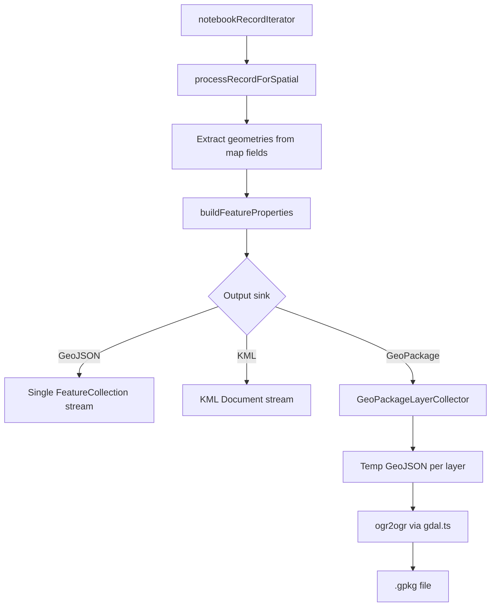

# Geospatial export pipeline

How the API turns notebook map fields into GeoJSON, KML, and GeoPackage (`.gpkg`) files.

## Formats and entry points

| Format     | MIME / extension                               | Typical use               |
| ---------- | ---------------------------------------------- | ------------------------- |
| GeoJSON    | `application/geo+json`, `.geojson`             | Web maps, modern GIS      |
| KML        | `application/vnd.google-earth.kml+xml`, `.kml` | Google Earth              |
| GeoPackage | `application/geopackage+sqlite3`, `.gpkg`      | QGIS, ArcGIS, desktop GIS |

**HTTP (single-use download grant)** — `GET /api/notebooks/:id/records/export?format=…` with `Authorization: Bearer`. Redeem `GET /api/notebooks/download/:grantId` with the same Bearer (headless/API) or the HttpOnly cookie set on mint (Control Centre). The URL id is not a capability.

- `geojson`, `kml`, `geopackage` — one format, streamed to the client
- `full` — ZIP archive; spatial formats controlled by `includeGeoJSON`, `includeKML`, `includeGeoPackage` (all default `true`)
- Optional exclusive `updatedAfter` / `updatedBefore` (epoch milliseconds) restrict which records are walked. The same bounds apply to CSV, ZIP, and full export. See [Records CRUD API](RecordsCRUDApi.md).

**Implementation files** (under `api/src/couchdb/export/`):

| File                  | Role                                                                         |
| --------------------- | ---------------------------------------------------------------------------- |
| `geospatialExport.ts` | Record iteration, feature extraction, format writers, archive fan-out        |
| `gdal.ts`             | `ogr2ogr` wrapper for GeoPackage conversion                                  |
| `fullExport.ts`       | Full ZIP orchestration (calls spatial export once for all requested formats) |
| `types.ts`            | `FullExportConfig` including `includeGeoPackage`                             |

Web UI: project export form and full-export checkboxes in `web/src/components/forms/`.

## Pipeline overview

Every export path funnels through **`iterateSpatialFeatures`**: one walk over notebook records (honouring an optional exclusive `updatedAfter` / `updatedBefore` window), one call to `onFeature` per geometry. Archive exports use **`appendSpatialFormatsToArchive`**, which fans the same features to every enabled format in that single pass (no second DB scan when full export requests GeoJSON + KML + GeoPackage together).

## Record → feature

1. **`initSpatialExportContext`** — loads UI spec, builds `viewFieldsMap`, sets `hasSpatialFields`.
2. **`notebookRecordIterator`** — hydrates records (attachments excluded for export).
3. **`processRecordForSpatial`** — for each spatial field on the record's form:
   - Reads GeoJSON from the field value (`Feature` or first feature of `FeatureCollection`)
   - Builds tabular properties via `convertDataForOutput` (same columns as CSV export)
   - Adds geometry-source metadata (`geometry_source_field_id`, etc.)
4. **`buildFeatureProperties`** — merges record properties with geometry-source fields.

Unsupported geometry types (e.g. `GeometryCollection`) are skipped with a console warning.

## GeoJSON and KML

- **GeoJSON**: one `FeatureCollection`; features written incrementally to a stream.
- **KML**: one `Document`; each geometry becomes a `Placemark` named with the record HRID.

Both are true streams for standalone download. In a full ZIP they use `PassThrough` streams appended to the archiver.

## GeoPackage

GeoPackage is **not** streamed end-to-end:

1. During iteration, **`GeoPackageLayerCollector`** writes features into **one temp GeoJSON file per layer**.
2. Layer name: `{form_id}_{geometry_type}` (e.g. `site_survey_point`). `Point` and `MultiPoint` share the `point` suffix; names are sanitised and capped at 63 characters.
3. After iteration, **`convertLayeredGeoJsonToGeoPackage`** (`gdal.ts`) runs `ogr2ogr` once per layer (first creates the `.gpkg`, rest append).
4. The finished `.gpkg` is read from disk and appended to the archive or HTTP response.

**Requirement:** GDAL on PATH (`ogr2ogr`). Included in API Docker image and devcontainer; optional on native dev (`gdal-bin` plus `poppler-utils`, or Homebrew `gdal` and `poppler`). `./dev.sh` warns if `ogr2ogr` or the PDF driver is missing.

## Map-layer ingest

Control Centre uploads are stored as Couch metadata in the `mapassets` database. File bytes go to object storage (AWS S3 in production, local RustFS in `./dev.sh`). Each asset document records the exact location in `storedAttachments` (`provider`, `resourceUri`, content type, byte size, optional S3 `endpoint`) for `original`, companion files, and `normalized`. For S3 the URI is `s3://{region}/{bucket}/{key}`. The combined upload may be at most 2 GB (8 files).

The HTTP request writes files to disk (`multer` disk storage) and returns `201` while the asset is `processing`. After the response, the API streams originals to object storage and deletes the local staging directory. Nothing on that path buffers the whole original in RAM. GDAL does not run in the API process.

A spatial worker then downloads the originals, runs GDAL, and streams the normalized PMTiles archive back to object storage. Workers poll the Couch `processing` queue (one asset at a time per process) and exit after `SPATIAL_WORKER_IDLE_EXIT_MS` with no claim (`0` never exits). A capacity manager is the only process that starts workers. It maps total queue depth (`inFlight` + `unclaimed`) through `CAPACITY_SCALE_THRESHOLDS` (`3,8,16,32` by default: 1→2 at 3 jobs, 2→3 at 8, and so on), caps at `CAPACITY_MAX`, and calls a pluggable capacity provider (`ECS`, `FIXED`, or `MOCK`). The provider adds capacity; it does not stop in-flight workers.

On AWS the manager is a small Fargate service (desired 1). It `RunTask`s worker tasks. There is no worker ECS service, so an idle exit is not replaced and compute returns to zero. Locally and on-prem, `CAPACITY_PROVIDER=FIXED` and a compose / always-on worker polls with idle exit disabled. If the API dies after `201` but before the S3 put, a sweep on that host retries from leftover staging. If the staging files are gone and originals were never stored, the sweep marks the asset `failed`.

The field app and Control Centre download the device-ready file directly from object storage. `GET /api/map-assets/:id/download-url` (Bearer) returns a JSON grant (`url`, `mediaType`, `filename`, `byteSize`, `expiresInSeconds`). The client then `GET`s `url` — Conductor does not stream the bytes. Grants last one hour. When the API reaches RustFS on an internal hostname, set `ATTACHMENT_S3_PUBLIC_ENDPOINT` (e.g. `http://localhost:9000`) so the signed host is reachable from the browser. Docker `--all` and the compose API service set that automatically. The bucket allows CORS `GET`/`HEAD` (CDK in AWS; Conductor applies it on local RustFS).

### Local object storage (RustFS)

`./dev.sh` / `./localdev.sh` start RustFS beside CouchDB, plus `capacity-manager` and `spatial-worker` (`docker compose up -d couchdb rustfs capacity-manager spatial-worker`). The worker image (`faims-dev-worker:local`, Dockerfile.dev target `worker`) has GDAL, tippecanoe, and pmtiles, and does not bake application source. Rebuild it with `--build` only when `Dockerfile.dev` or the lockfile changes. Its scratch directory is the `spatial_scratch` volume, not the API container's disk.

| Service | URL                                |
| ------- | ---------------------------------- |
| S3 API  | http://localhost:9000              |
| Console | http://localhost:9001              |
| Health  | `GET http://localhost:9000/health` |

`api/.env.dist` points Conductor at that endpoint with static local keys (`faimsdev` / `faimsdevsecret1`). `./localdev.sh --all` overrides `ATTACHMENT_S3_ENDPOINT` to `http://rustfs:9000` so the API container uses Docker DNS, and `ATTACHMENT_S3_PUBLIC_ENDPOINT` to `http://localhost:9000` so presigned downloads work from the host browser. On AWS ECS, omit the keys and endpoint — the task role authenticates, and CDK creates the bucket with CORS for client GETs.

Admin smoke test (operations / general admin): `POST /api/admin/test-attachment-storage`. It uploads, heads, downloads, presigns, and deletes a tiny probe object.

The storage backend is selected like email: `ATTACHMENT_STORAGE_TYPE=S3` or `MOCK` (forced under test). Implementation: `api/src/services/attachmentStorageService.ts`.

A rejected or aborted upload deletes its `req-*` staging directory: multer size/count errors and a client disconnect both clean up. Before the stream starts, the API checks free space on `os.tmpdir()`. If less than three times the 2 GB cap remains (room for the original plus a copy while it uploads to object storage), it returns **503** with `MAP_ASSET_UPLOAD_BUSY_MESSAGE`. The Control Centre shows that text rather than a generic failure. AWS Conductor ephemeral storage defaults to **21 GiB**. GDAL scratch is on the spatial worker task (`spatialCapacity.ephemeralStorageGiB`, default **80**, range 21–200).

Node 18+ defaults `server.requestTimeout` to 5 minutes, which would abort a slow 2 GB upload. Conductor sets `requestTimeout` to 1 hour (`headersTimeout` slightly higher). That is a process-wide HTTP server setting, not per-route. An AWS ALB idle timeout is still typically 60 seconds: a continuously sending upload stays alive; a paused upload can still be cut. DigitalOcean nginx in this repo sets `client_max_body_size 0` but inherits the default 60s `proxy_read_timeout` unless you raise it.

Accepted uploads:

- GeoJSON (`.geojson`, `.json`)
- GeoPackage (`.gpkg`)
- Zipped shapefile, including `.shp`, `.shx`, `.dbf`, and `.prj`
- Zipped ESRI File Geodatabase (`.gdb.zip`, or a `.zip` with one `.gdb` folder). GDAL OpenFileGDB reads it; ArcGIS / Pro "Export File Geodatabase" zips work. A zip with more than one `.gdb` is rejected. Feature classes are merged into one layer. Domains, subtypes, relationships, and attachments are dropped.
- KML (`.kml`)
- GeoTIFF (`.tif`, `.tiff`)
- Georeferenced PDF (`.pdf`)
- PNG or JPEG with a world file and a `.prj`

GDAL must report a CRS. Uploads with no CRS are marked `failed` and no normalized attachment is stored. The failure text is the GDAL message.

Every accepted file becomes one PMTiles archive (`application/vnd.pmtiles`):

- Vectors are reprojected to a geometry-only layer in `EPSG:4326` (`ogr2ogr -t_srs EPSG:4326 -nln features -select ""`), then tiled with `tippecanoe -zg --drop-densest-as-needed --extend-zooms-if-still-dropping -l features`. By default ogr2ogr writes **GeoJSONSeq** (one Feature per line) so `tippecanoe --read-parallel` can parse the file with multiple threads. Set `TIPPECANOE_READ_PARALLEL=false` to keep an RFC7946 FeatureCollection and skip `-P`. Every source layer is written into that one layer, so a multi-folder KML, multi-layer GeoPackage, or File Geodatabase becomes a single overlay. Feature attributes are dropped — the app only draws geometry. The intermediate file is deleted after tiling.
- Rasters, including georeferenced PDFs, are warped to `EPSG:3857`. A PDF is rasterized at GDAL's default 150 DPI. `gdalwarp` uses `-multi`, `-wm`, and `NUM_THREADS` from config (defaults: 256 MB warp buffer, `ALL_CPUS`). GDAL writes WebP MBTiles at the native zoom, `gdaladdo` fills the lower zooms, and `pmtiles convert` writes the archive. The MBTiles file is deleted after conversion. The asset document stores the placement extent plus `minZoom`, `maxZoom`, and `tileSize` (256) from the archive header.

Worker thread / memory knobs (env or CDK `spatialCapacity`): `GDAL_NUM_THREADS` (`ALL_CPUS` or an integer), `GDAL_CACHEMAX` (MB), `GDAL_WARP_MEMORY_MB` (`gdalwarp -wm`), `GDAL_WARP_MULTI`, `TIPPECANOE_MAX_THREADS` (omit = all CPUs), `TIPPECANOE_READ_PARALLEL`. Conservative defaults (256 MB cache and warp buffer) fit a 1 vCPU / 2 GiB worker. Raise cache toward 1024–2048 MB and warp memory toward 1024 MB on an 8 vCPU / 32 GiB task. CDK copies these onto the worker task only.

The worker claims an asset with `processingStartedAt` and refreshes that timestamp while GDAL runs, so a long raster is not stolen. `processingAttempts` counts claims. The claim window is 2 hours, longer than the 60-minute GDAL command timeout. A fresh claim is left alone. After three claims the asset is marked `failed`. A GDAL error fails the asset immediately and is not retried. Workers do not claim a job until originals are in object storage. Replacing the file clears the claim, the attempt count, and the previous object-store pointers.

Implementation: `api/src/couchdb/mapAssets/normalize.ts` and `api/src/couchdb/mapAssets/store.ts` (claim, original upload, GDAL), `api/src/scripts/spatialWorker.ts` (poll until idle), `api/src/scripts/capacityManager.ts` (queue depth → capacity), `api/src/services/capacityProvider.ts` (ECS / FIXED / MOCK). Command helpers live in `api/src/couchdb/export/gdal.ts`. Docker images install GDAL, Poppler, tippecanoe 2.79.0, and the go-pmtiles 1.28.1 CLI (`pmtiles`). The image build fails unless `gdalinfo --formats` lists PDF, MBTiles, and WEBP. `PMTILES_BIN` and `TIPPECANOE_BIN` override the executable names; `pmtiles` falls back to `go-pmtiles`. GeoPackage export still runs GDAL inside the API process.

## Full export behaviour

`streamFullExport` builds a `SpatialArchiveFormatConfig` from `FullExportConfig` and calls **`appendSpatialFormatsToArchive` once**. Spatial files land under `spatial/export.geojson`, `spatial/export.kml`, and/or `spatial/export.gpkg` inside the ZIP.

If the notebook has no map fields, spatial files are omitted and warnings are recorded in export metadata.

## Developer tooling

**Bulk test records** (`DEVELOPER_MODE`, `POST /api/notebooks/:id/generate`):

- Map fields get random geometries in mainland Australia
- `includeAttachments` and `parallelism` control speed vs load

See also [TestDatasetSeeding](TestDatasetSeeding.md) for seeded projects.

## Testing and extension

- **Unit tests:** `api/test/geopackageExport.test.ts` — layer naming only (no GDAL in CI).
- **Manual:** export a notebook with Point/Line/Polygon map fields; open `.gpkg` in QGIS.

To add a new spatial format: hook into `iterateSpatialFeatures` or extend `appendSpatialFormatsToArchive` with another sink in the fan-out callback. Keep one record iteration for combined archive exports.

## Related docs

- [Records CRUD API](RecordsCRUDApi.md) — per-record reads; bulk files use export API
- User-facing overview: `docs/user/data-export/export.md`
