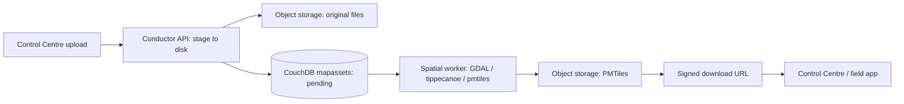

# Map Layers

Map layers are reference overlays — basemaps, survey areas, historic maps —
that a survey can display in the field app. An administrator uploads a GIS
file in the Control Centre, a background worker converts it to PMTiles, and
field devices download and keep a local copy.

This page covers that pipeline end to end: upload → conversion → download →
on-device storage.

> **Not this page:** exporting _record_ geometry as GeoJSON / KML /
> GeoPackage. See [Geospatial export pipeline](GeospatialExport.md).

## At a glance

Every asset moves through the same states:

| Status       | Meaning                                           |
| ------------ | ------------------------------------------------- |
| `pending`    | Upload accepted; waiting for storage or a worker  |
| `processing` | A worker has claimed the job and is converting it |
| `ready`      | PMTiles stored; available to surveys and devices  |
| `failed`     | Conversion or upload failed; see the failure text |

Two design points explain most behaviour below:

- **The API never runs GDAL and never streams file bytes to clients.** It
  stages uploads, stores originals, and issues signed URLs. Workers convert;
  clients download directly from object storage.
- **Nothing buffers a whole file in RAM.** Uploads, originals, and results
  are streamed between disk and object storage.

## Accepted uploads and output

Combined upload limit: **2 GB across at most 8 files** (original plus any
companion files).

| Upload                                    | Notes                                              |
| ----------------------------------------- | -------------------------------------------------- |
| GeoJSON (`.geojson`, `.json`)             | A legacy collection-level `crs` member is honoured |
| GeoPackage (`.gpkg`)                      | All layers merged into one overlay                 |
| Zipped shapefile (`.shp/.shx/.dbf/.prj`)  | Upload as one zip                                  |
| Zipped ESRI File Geodatabase (`.gdb.zip`) | See notes below                                    |
| KML (`.kml`)                              | All folders merged into one overlay                |
| GeoTIFF (`.tif`, `.tiff`)                 | Embedded CRS is used; a stray `.prj` is ignored    |
| Georeferenced PDF (`.pdf`)                | Embedded CRS is used; treated as a raster          |
| PNG / JPEG + world file + `.prj`          | The sibling `.prj` supplies the CRS (images only)  |

File Geodatabase specifics: a `.zip` containing exactly one `.gdb` folder
also works (more than one is rejected). Feature classes are merged into one
layer. Domains, subtypes, relationships, and attachments are dropped.

**A CRS is required.** GDAL must be able to report one; otherwise the asset
is marked `failed` with the GDAL error as the failure text, and no
normalized file is stored.

### Output: one PMTiles archive per asset

Every accepted file becomes a single PMTiles archive
(`application/vnd.pmtiles`):

| Source type        | Conversion                                                                 | Projection  |
| ------------------ | -------------------------------------------------------------------------- | ----------- |
| Vector             | `ogr2ogr` to an intermediate (FlatGeobuf or GeoJSONSeq), then `tippecanoe` | `EPSG:4326` |
| Raster (incl. PDF) | `gdalwarp` to WebP MBTiles, `gdaladdo` overviews, then `pmtiles convert`   | `EPSG:3857` |

Both paths drop feature attributes (the app only draws geometry), merge all
source layers into one overlay layer, and delete intermediates afterwards.
Raster assets also store their placement extent plus `minZoom`, `maxZoom`,
and `tileSize` (256) from the archive header.

Exact tool flags and the edge cases behind them are in
[Appendix: conversion details](#appendix-conversion-details).

## How an upload is processed

1. **Stage.** The API writes the multipart upload to local disk (`multer`
   disk storage) and returns `201` with the asset `pending`. Rejected or
   aborted uploads delete their staging directory.
2. **Store originals.** After responding, the API streams the files to
   object storage and deletes the staging directory. The asset document in
   the CouchDB `mapassets` database records each file in
   `storedAttachments` (`original`, companions, later `normalized`): provider,
   `resourceUri` (`s3://{region}/{bucket}/{key}` on S3), content type, byte
   size, and optional S3 `endpoint`.
3. **Convert.** A spatial worker claims the job (`pending` → `processing`),
   downloads the originals, runs GDAL, and streams the PMTiles result back to
   object storage. The API process never runs GDAL.
4. **Publish.** On success the asset becomes `ready`. On a GDAL error it
   becomes `failed` immediately (no retry — see
   [Failures and retries](#failures-and-retries)).
5. **Download.** Clients fetch a signed URL (below) and download the PMTiles
   directly from object storage.

### Downloads

`GET /api/map-assets/:id/download-url` (Bearer auth) returns a grant:
`url`, `mediaType`, `filename`, `byteSize`, `expiresInSeconds`. Grants last
**one hour**. Conductor does not proxy the bytes.

If the API reaches object storage on an internal hostname (local RustFS),
set `ATTACHMENT_S3_PUBLIC_ENDPOINT` (e.g. `http://localhost:9000`) so the
signed URL is reachable from the browser. Docker `--all` and the compose API
service set this automatically. The bucket allows CORS `GET`/`HEAD` (via CDK
on AWS; Conductor configures local RustFS itself).

## Workers and scaling

Only the **capacity manager** (`api/src/entrypoints/capacityManager.ts`)
starts workers. It watches queue depth (`inFlight` + `unclaimed`) and asks a
provider to add workers; it never stops one mid-job — workers exit on their
own when idle.

Workers (`api/src/entrypoints/spatialWorker.ts`):

- Poll CouchDB for `pending` and stale `processing` jobs, one asset at a time
- Do not claim a job until its originals are in object storage
- Exit after `spatialCapacity.idleExitMs` with no claim (`0` = never exit)

Providers (`spatialCapacity.provider`):

| Provider | Used for        | Behaviour                                                                                                                                                           |
| -------- | --------------- | ------------------------------------------------------------------------------------------------------------------------------------------------------------------- |
| `ECS`    | AWS             | Manager is a Fargate service (desired count 1) that `RunTask`s workers. There is no worker ECS service, so an idle exit is not replaced and compute returns to zero |
| `FIXED`  | Local / on-prem | A compose or always-on worker polls with idle exit disabled                                                                                                         |
| `MOCK`   | Tests           | Fake provider                                                                                                                                                       |

### Scaling knobs

All under `spatialCapacity` in `core.json` (see
[Build configuration](Build-Configuration.md)):

| Setting             | Default                                         | Effect                                                                 |
| ------------------- | ----------------------------------------------- | ---------------------------------------------------------------------- |
| `scaleThresholds`   | `[3, 8, 16, 32]`                                | Queue depths that raise worker count: 1→2 at 3 jobs, 2→3 at 8, …       |
| `maxCapacity`       | — (hard cap)                                    | Worker count never exceeds this, nor the number of queued jobs         |
| `starvationMs`      | 5 min (`0` disables)                            | If the oldest unclaimed job has waited this long, add one extra worker |
| `scaleInCooldownMs` | 2 × `starvationMs` (`0` = only the first extra) | Minimum gap before the same stale job earns another extra worker       |

## Survey listings and on-device copies

`GET /api/directory` and the notebook list/get endpoints attach
`contextualLayers` to each survey: **only `ready` assets linked to that
survey**. `pending`, `processing`, and `failed` assets are omitted, even
though the survey link still exists.

That array is the field app's **keep-set**. On directory refresh, an
activated survey deletes any on-device layer whose id is not listed (a file
still used by another survey is kept).

> ⚠️ **Absent is not empty.** If the field is omitted entirely (e.g. the
> manifest attach failed), the app treats that as "unknown" and deletes
> nothing. Only a present-but-smaller list triggers cleanup.

### Replacing a file invalidates the old one immediately

Replace is _not_ last-good-wins. Once a replacement is staged:

- The previous object-storage blobs are deleted
- The asset leaves survey listings until the new file is `ready`
- Devices holding the old file delete it on next refresh, then download the
  new file when it appears

A withdrawn overlay is never kept as a fallback. This is intentional.

## Limits, timeouts, and failures

### Size and disk

- Before an upload streams, the API checks free space on `os.tmpdir()`. If
  less than **3 × the 2 GB cap** remains (original plus working copy), it
  returns **503** with `MAP_ASSET_UPLOAD_BUSY_MESSAGE`, which the Control
  Centre shows verbatim instead of a generic error.
- AWS Conductor ephemeral storage defaults to **21 GiB**. GDAL scratch lives
  on the worker task: `spatialCapacity.ephemeralStorageGiB`, default **80**
  (range 21–200).

### Timeouts

- Node's default `server.requestTimeout` (5 min) would kill slow 2 GB
  uploads, so Conductor sets it to **1 hour** (`headersTimeout` slightly
  higher). This is process-wide, not per-route.
- An in-flight upload is bounded to **2 hours**. Overrun marks the asset
  `failed`. A background sweep does the same for `pending` assets abandoned
  by a crash or reload (no stored originals 2 hours after
  `originalUploadStartedMs`). A late object-store write never overwrites a
  `failed` or replaced document, and never deletes a replacement's staging
  files.
- Proxies can still cut _paused_ uploads: an AWS ALB idles out at ~60 s and
  the DigitalOcean nginx config inherits a 60 s `proxy_read_timeout` (its
  `client_max_body_size` is unlimited). A continuously sending upload stays
  alive.

### Failures and retries

Claiming a job sets `status: processing`, `processingStartedAt`, and a
heartbeat (`processingHeartbeatMs`, refreshed by every claim, stage, and
progress write). `processingAttempts` counts claims.

- No heartbeat for **2 hours** → the job is treated as abandoned and can be
  claimed again
- After **3 claims** → marked `failed`
- A **GDAL error** → `failed` immediately, not retried

Replacing a file resets all of this: back to `pending`, a fresh
`originalUploadStartedMs`, and claim, attempt count, heartbeat, and previous
storage pointers cleared. (A rename does none of this.) Note `updatedAt` is
only the last _user-facing_ change — create, rename, replace, ready/failed —
and is what listings sort by; processing writes do not touch it.

## Processing progress

While processing, the asset carries two fields (both cleared on `ready` /
`failed`):

- `processingStage` — a stable step id: `uploading`, `queued`, `downloading`,
  `extracting-archive`, `flattening-geojson`, `interpreting-crs`,
  `converting-geometries`, `tiling-vectors`, `warping-raster`,
  `building-tiles`, `building-overviews`, `converting-tiles`, `storing`
- `processingProgress` — stage-specific detail the Control Centre renders
  (e.g. "Building vector tiles — Reordering geometry 45%") and polls with the
  rest of the asset:

| Stage(s)                                                 | Progress value                       |
| -------------------------------------------------------- | ------------------------------------ |
| `flattening-geojson`                                     | Bytes consumed (`Flattening` / 45)   |
| `tiling-vectors`                                         | tippecanoe phase + percent           |
| `warping-raster`, `building-tiles`, `building-overviews` | GDAL progress ticks (`Warping` / 45) |

`converting-tiles` (`pmtiles convert`) reports no live percent. Progress
writes also refresh the claim heartbeat, so a long GeoTIFF step is not
stolen by another worker.

## Local development (RustFS)

`./dev.sh` / `./localdev.sh` start CouchDB and RustFS first, migrate Couch,
then start `capacity-manager` and `spatial-worker`.

| Service | URL                                |
| ------- | ---------------------------------- |
| S3 API  | http://localhost:9000              |
| Console | http://localhost:9001              |
| Health  | `GET http://localhost:9000/health` |

- The worker image (`faims-dev-worker:local`, `Dockerfile.dev` target
  `worker`) ships GDAL, tippecanoe, and pmtiles but no application source —
  it bind-mounts `api/src`. Rebuild with `--build` **only** when
  `Dockerfile.dev` or the lockfile changes. Its scratch space is the
  `spatial_scratch` volume, not the API container's disk.
- `api/.env.dist` points Conductor at RustFS with static local keys
  (`faimsdev` / `faimsdevsecret1`). `./localdev.sh --all` overrides
  `ATTACHMENT_S3_ENDPOINT` to `http://rustfs:9000` (Docker DNS inside the API
  container) and `ATTACHMENT_S3_PUBLIC_ENDPOINT` to
  `http://localhost:9000` (host browser). On AWS, omit keys and endpoint —
  the task role authenticates and CDK creates the bucket with CORS.
- Storage backend: `ATTACHMENT_STORAGE_TYPE=S3` or `MOCK` (forced under
  test), mirroring the email backend switch.
- Smoke test: `POST /api/admin/test-attachment-storage` uploads, heads,
  downloads, presigns, and deletes a tiny probe object.

## Performance tuning

Worker memory/thread knobs, also under `spatialCapacity` in `core.json`:

| Setting                | Meaning                   |
| ---------------------- | ------------------------- |
| `gdalNumThreads`       | `ALL_CPUS` or an integer  |
| `gdalCacheMaxMb`       | GDAL cache size           |
| `gdalWarpMemoryMb`     | `gdalwarp -wm` buffer     |
| `gdalWarpMulti`        | `gdalwarp -multi` on/off  |
| `tippecanoeMaxThreads` | Optional; omit = all CPUs |

Defaults (256 MB cache and warp buffer) fit a 1 vCPU / 2 GiB worker. On an
8 vCPU / 32 GiB task, raise cache toward 1024–2048 MB and warp memory toward
1024 MB. On AWS, CDK applies these to the worker task only.

## Implementation map

| Area                                | Files                                          |
| ----------------------------------- | ---------------------------------------------- |
| Asset store, claim, original upload | `api/src/couchdb/mapAssets/store.ts`           |
| GDAL conversion                     | `api/src/couchdb/mapAssets/normalize.ts`       |
| Object storage backend              | `api/src/services/attachmentStorageService.ts` |
| Worker loop                         | `api/src/entrypoints/spatialWorker.ts`         |
| Capacity manager                    | `api/src/entrypoints/capacityManager.ts`       |
| Providers (ECS / FIXED / MOCK)      | `api/src/services/capacityProvider.ts`         |
| GDAL command helpers                | `api/src/couchdb/export/gdal.ts`               |

Docker images install GDAL, Poppler, unzip, tippecanoe 2.79.0, and the
go-pmtiles 1.28.1 CLI. The build fails unless `gdalinfo --formats` lists PDF,
MBTiles, and WEBP. `PMTILES_BIN` and `TIPPECANOE_BIN` override executable
names (`pmtiles` falls back to `go-pmtiles`).

Note the one exception to "no GDAL in the API": GeoPackage _export_ still
runs GDAL in the API process — see
[Geospatial export pipeline](GeospatialExport.md).

## Appendix: conversion details

Reference for the vector/raster tool invocations and the edge cases behind
them. Safe to skip unless you are debugging a conversion.

### Vectors

The intermediate format depends on the layer's geometry types:

- **Homogeneous** Point/Line/Polygon layers → FlatGeobuf
  (`ogr2ogr -f FlatGeobuf -nlt PROMOTE_TO_MULTI`). `-explodecollections` is
  deliberately omitted here: combined with `PROMOTE_TO_MULTI` it produces a
  mismatched-geometry error on typical File Geodatabase polygon classes.
- **Mixed or unknown** layers (GeometryCollections, MultiLineString beside
  polygons, multi-folder KML) → RFC 8142 GeoJSONSeq with
  `-explodecollections`, because tippecanoe's FlatGeobuf reader rejects
  unknown header geometry types.

tippecanoe then tiles one `features` layer, by geometry family:

| Family        | Key flags                                                                                                                                                                                          |
| ------------- | -------------------------------------------------------------------------------------------------------------------------------------------------------------------------------------------------- |
| Polygons      | `-z 16 --hilbert --drop-fraction-as-needed --drop-polygons --drop-rate=3 --base-zoom=10 --maximum-tile-bytes=80000 --simplification=10 --simplify-only-low-zooms --extend-zooms-if-still-dropping` |
| Points        | `-z 14 --drop-densest-as-needed --drop-rate=g --maximum-tile-bytes=80000 --maximum-tile-features=5000 --hilbert --extend-zooms-if-still-dropping`                                                  |
| Lines / mixed | `-z 14 --drop-densest-as-needed --extend-zooms-if-still-dropping`                                                                                                                                  |

Extra zooms are added only if a tile at the family max zoom still overflows
after dropping. Two deliberate choices in the polygon flags:

- `--drop-fraction-as-needed`, not `--coalesce`: attributes are stripped, so
  coalescing would dissolve neighbouring parcels at every zoom. It also
  avoids `--coalesce-smallest-as-needed`, which tippecanoe 2.78+ exits 100
  on when the area threshold cannot increase.

Pre-processing edge cases:

- GeoJSON is opened with `-oo RFC7946=NO` so a legacy collection-level `crs`
  is honoured; flattening copies that root `crs` onto the rewritten
  FeatureCollection before `ogrinfo` / `ogr2ogr`.
- FeatureCollections nested inside a FeatureCollection are flattened to leaf
  Features first (`-explodecollections` does not walk that nesting).
- A zipped File Geodatabase is extracted to scratch before `ogr2ogr` so GDAL
  does not read through `/vsizip`.

### Rasters

- PDFs are rasterized at GDAL's guessed DPI (150 fallback) with
  `-oo LAYERS=ALL`, keeping optional-content collar/surround groups visible.
- `gdalwarp` uses `-multi`, `-wm`, and `NUM_THREADS` from config (defaults:
  256 MB warp buffer, `ALL_CPUS`). Progress comes from the default
  `GDALTermProgress` stdout (these tools have no `-progress` flag).
- Output is WebP MBTiles at `QUALITY=90` — the MBTiles driver has no lossless
  WebP — at native zoom; `gdaladdo` fills lower zooms and `pmtiles convert`
  writes the final archive.
