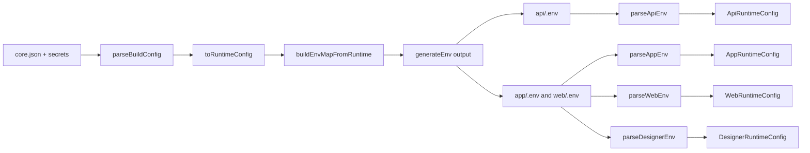

# @faims3/build-config

Central typed configuration module for FAIMS3 build-time and client runtime configuration.

This package is the single source of truth for two layers:

1. **Layer 1 — deployment JSON.** `core.json` (+ merged secrets) is validated by
   `BuildConfigSchema` / `parseBuildConfig` into a typed `RuntimeConfig`, then
   emitted as platform `.env` files via `buildEnvMapFromRuntime` / `generateEnv`.
2. **Layer 2 — client ENV.** Each runnable client parses its own env with a
   dedicated schema (`parseApiEnv`, `parseAppEnv`, `parseWebEnv`,
   `parseDesignerEnv`) into a typed client runtime config. Required endpoints,
   credentials, and identity fail fast. There is no silent `localhost` or
   placeholder-credential fallback at ENV parse time.

Shared Zod enums, operational defaults, and coercion helpers live in
[src/shared-schemas.ts](src/shared-schemas.ts) and
[src/env-coercion.ts](src/env-coercion.ts) so the two layers cannot drift on
meaning.

## Goals

- One canonical JSON schema for deployment configuration
- Client-specific ENV schemas that declare required vs optional vs defaulted
- Strict validation (reject unknown JSON keys and bad env types)
- Explicit environment contract for generated env keys
- Deterministic tests for config behavior

## Current Architecture

Core entry points:

- Layer 1 JSON schemas and runtime model: [src/build-config.ts](src/build-config.ts)
- Shared enums / defaults / invariants: [src/shared-schemas.ts](src/shared-schemas.ts)
- ENV coercion helpers: [src/env-coercion.ts](src/env-coercion.ts)
- Layer 2 client parsers: [src/client-env/](src/client-env/)
- Env contract map: [src/env-contract.ts](src/env-contract.ts)
- Env generator CLI: [src/generate-build-config.ts](src/generate-build-config.ts)
- Config validate CLI: [src/validate-build-config.ts](src/validate-build-config.ts)
- Node `.env.dist` loader: [src/node.ts](src/node.ts) (`@faims3/build-config/node`)
- Tests: [test/generate-build-config.test.ts](test/generate-build-config.test.ts),
  [test/validate-build-config.test.ts](test/validate-build-config.test.ts),
  [test/client-env.test.ts](test/client-env.test.ts),
  [test/node.test.ts](test/node.test.ts)

Data flow:



Key design idea:

- JSON meaning is defined once in the canonical Layer 1 model.
- Environment keys are transport, defined in an explicit mapping contract.
- Each client declares its own required ENV and maps into a typed client object.
- Shared enums and `SHARED_DEFAULTS` are reused; fake credentials and silent
  localhost fallbacks are not.

## Runtime Shape

Layer 1 (`RuntimeConfig`) is a single, fully-populated object namespaced into
the same thematic top-level groups as the input JSON
(see [Input Shape](#input-shape-grouped)). Every field that has a default is
always present in the parsed result; genuinely-optional fields (e.g.
`bugsnagApiKey`, `satelliteSource`, `appShortName`, `couchdb.password`) are
`| undefined`.

Layer 2 outputs four client-specific objects:

| Parser             | Required ENV (fail fast if missing/blank)                                                                                                            | Consumer                                                                 |
| ------------------ | ---------------------------------------------------------------------------------------------------------------------------------------------------- | ------------------------------------------------------------------------ |
| `parseApiEnv`      | `CONDUCTOR_PUBLIC_URL`, `WEB_APP_PUBLIC_URL`, `COUCHDB_INTERNAL_URL`, `COUCHDB_PUBLIC_URL`, `COUCHDB_USER`, `COUCHDB_PASSWORD`, `REDIRECT_WHITELIST` | [api/src/buildconfig.ts](../../api/src/buildconfig.ts)                   |
| `parseAppEnv`      | `VITE_CONDUCTOR_URL`, `VITE_APP_NAME`, `VITE_APP_ID`                                                                                                 | [app/src/buildconfig.ts](../../app/src/buildconfig.ts)                   |
| `parseWebEnv`      | `VITE_WEB_URL`, `VITE_API_URL`, `VITE_APP_URL`, `VITE_APP_NAME`                                                                                      | [web/src/constants.ts](../../web/src/constants.ts)                       |
| `parseDesignerEnv` | none (both flags defaulted)                                                                                                                          | [web/src/designer/buildconfig.ts](../../web/src/designer/buildconfig.ts) |

Conditionally required: `AWS_SECRET_KEY_ARN` when `KEY_SOURCE=AWS_SM`; SMTP
host/user/password when `EMAIL_SERVICE_TYPE=SMTP` and not under test; Mapbox /
MapTiler autosuggest keys when that source is enabled.

Omitted optional tuning values use `SHARED_DEFAULTS` (batch sizes, token
windows, limiter settings). Present-but-invalid values fail parse.

See Layer 1 definitions in [src/build-config.ts](src/build-config.ts) and Layer
2 in [src/client-env/](src/client-env/).

## Input Shape (Grouped)

Build config JSON now uses thematic top-level groups instead of per-application buckets.

Top-level groups include:

- `endpoints`
- `branding`
- `support`
- `notebookAndRecordUX`
- `maps`
- `sync`
- `attachments`
- `migration`
- `auth`
- `authProviders`
- `authTokens`
- `limits`
- `email`
- `observability`
- `teamAndRolePolicy`
- `webDesignerLimits`
- `android`
- `ios`
- `couchdb`
- `conductor`
- `dev`
- `pouchdb`

Some previously duplicated values are now merged under one canonical setting and derived where needed (for example URL aliases and shared long-lived token duration policy).

There is deliberately **no** untyped `secrets` passthrough. Platform-level secrets (`PRIVATE_SIGNING_KEY`, `PUBLIC_SIGNING_KEY`, `SOPS_AGE_KEY`, `AWS_DEFAULT_REGION`, `GIT_AUTHORIZATION`) stay injected by the deployment platform / CI, not by the generated env. If a secret needs to flow through the JSON it gets an explicit named field with an env-contract mapping.

## Strict Validation Rules

Validation is intentionally strict:

- Source JSON objects are strict and reject unknown keys.
- Environment parsing rejects invalid booleans, integers, and enums (fail, do not warn-and-default).
- Required values must be present or defaults must be declared.

This catches typo and drift early during CI/build. All three consumers now parse
their env through this module's strict parsers; the apps no longer keep their
own lenient `configHelpers` schemas.

## How To Add A New Configuration Option

Use this sequence every time.

1. Add meaning to canonical schema

- Add the field to the relevant schema section in [src/build-config.ts](src/build-config.ts).
- Prefer semantic grouping over app-specific naming.
- Decide required vs optional and default behavior.
- If the option is shared across targets, place it under shared semantics.

1. Add field to runtime model

- `RuntimeConfigSchema` is an alias of `BuildConfigSchema`; adding the field above is enough. `toRuntimeConfig` re-parses a partial object through that schema.

1. Add env transport mapping (if required)

- Add key mapping in [src/env-contract.ts](src/env-contract.ts).
- Map from runtime config to the generated environment key.
- Keep compatibility aliases only when needed; avoid duplicate semantic sources.

1. Add env parser support (if a client reads the new key)

- Add the field to the relevant client schema in [src/client-env/](src/client-env/)
  (`ApiEnvSchema`, `AppEnvSchema`, `WebEnvSchema`, or `DesignerEnvSchema`).
- Use `requiredEnvString` / `requiredEnvUrl` for identity and endpoints; use
  `boolWithDefault` / `intWithDefault` / `enumWithDefault` for operational
  defaults. Map the parsed value into that client's runtime config.

1. Add tests

- Add positive and negative tests:
  - valid JSON produces expected env ([test/generate-build-config.test.ts](test/generate-build-config.test.ts))
  - missing required ENV is rejected ([test/client-env.test.ts](test/client-env.test.ts))
  - invalid typed env is rejected
  - generateEnv → client parser round-trip is preserved

1. Run checks

- Run package tests:
  - pnpm --filter=@faims3/build-config test
- Run the shared quality targets (also covered by `./format-lint.sh` /
  `pnpm lint` / `pnpm typecheck`):
  - pnpm --filter=@faims3/build-config run typecheck
  - pnpm --filter=@faims3/build-config run lint

## Using This Config In Different Apps

This package is the single typed source that every target consumes. The shared
file layout is **`core.json`** (the non-secret config, all secret slots empty),
**`secrets.enc.json`** (the SOPS-encrypted secret values) and **`aws.json`** (the
AWS-only extension). SOPS platforms decrypt and merge `secrets.enc.json` over
`core.json`; the AWS CDK loads `{ core, aws }` and resolves secrets from Secrets
Manager. The JSON→env mapping is transport — see the developer-facing
[Build Configuration](../../docs/developer/docs/source/markdown/Build-Configuration.md)
page for the full JSON structure.

1. Build pipeline / CI

- Generate env from JSON with [src/generate-build-config.ts](src/generate-build-config.ts).
- Feed generated env into the platform/web/api build processes.

1. Runtime parsing

- `app` calls `parseAppEnv(import.meta.env, {appVersion})`.
- `web` calls `parseWebEnv(import.meta.env, {appVersion})`.
- `web` designer calls `parseDesignerEnv(import.meta.env)`.
- `api` calls `parseApiEnv(process.env)`.

Each consumer keeps only Node / UI-specific work local (key-file existence,
service singletons, Capacitor constants, team-role filtering). Plurals, URL
derivations, map config, and paired directory credentials are produced by the
client parsers.

## Consumer status

- `app` — [app/src/buildconfig.ts](../../app/src/buildconfig.ts) keeps the
  address-autosuggest factory and Capacitor platform constants.
- `web` — [web/src/constants.ts](../../web/src/constants.ts) filters
  `excludedTeamRoles` against known TEAM roles and attaches a few hardcoded
  Control Centre constants. Designer flags live in
  [web/src/designer/buildconfig.ts](../../web/src/designer/buildconfig.ts).
- `api` — [api/src/buildconfig.ts](../../api/src/buildconfig.ts) checks
  `existsSync(keyFilePath)` and instantiates the key/email service singletons.

Each consumer preserves its public `config` shape, so only `buildconfig.ts` /
`constants.ts` changed; no consumer components were touched.

## Migrating a legacy AWS config

`scripts/migrate-aws-config.ts` converts a legacy main-branch AWS CDK
config JSON — the flat shape with `uiConfiguration`, `conductor`, `smtp`,
`authProviders.config`, … — into the new layout. Given
an authenticated AWS environment it also pulls the Secrets Manager secrets
the legacy file only references by ARN (SMTP credentials, auth-provider
credentials, and the CDK-generated CouchDB-admin / cookie secrets, the
latter two discovered by name or via explicit ARN flags), using the `aws`
CLI from the caller's environment.

```bash
pnpm --filter=@faims3/build-config run migrate-aws --config path/to/legacy-dev.json --out-dir path/to/migrated/dev
```

It writes `core.json` (non-secret core; secret slots empty, except the
publishable map/Bugsnag client keys that were already plaintext),
`secrets.json` (the unencrypted secret overlay in the
`config/secrets.sample.json` shape — SOPS-encrypt it before committing
anywhere, written mode `0600`), `aws.json` (AWS-only extension, ARNs only),
and `migration-report.md` (field-level mapping notes, dropped
legacy keys, unresolved secrets — never secret values). `core.json` +
`aws.json` together form the env folder every consumer loads (CDK via
`CONFIG_ENV`/`CONFIG_DIR`, everything else via the config generators). Both `core.json`
alone and `core.json` deep-merged with `secrets.json` are validated
against `BuildConfigSchema` before anything is written. Secret values are
never printed or logged; the signing-key secrets are not exported at all
(they stay referenced by ARN — the API reads them via `KEY_SOURCE=AWS_SM`).
Use `--no-aws` for an offline dry run, `--help` for all options.

## Scripts

From this package:

- build: compiles the module to `build/` (consumers import the built output —
  run this, or rely on turbo's `^build`, before using the module from `api`,
  `web` or `app`). `dev` watches it.
- typecheck / lint / fix / clean: same turbo targets as the other packages, so
  `pnpm typecheck`, `pnpm lint`, and `./format-lint.sh` include this module.
- generate: emits env from config JSON
- generate platform values: `apps` (also accepts `android` / `ios` aliases, which
  the mobile CI workflows use) or `api`
- validate: parses `core.json` (`--config`, `--config-dir`, or `CONFIG_DIR`);
  optionally deep-merges a secrets overlay (`--secrets`, or `secrets.enc.json`
  via sops when a SOPS key is set)
- test: runs package tests

See [package.json](package.json).
