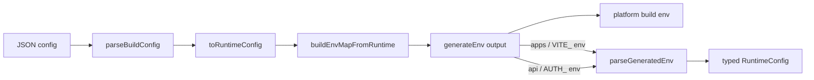

# @faims3/build-config

Central typed configuration module for FAIMS3 build-time and app runtime configuration.

This package is becoming the single source of truth for the config chain:

1. Source JSON configuration validation
2. Canonical typed runtime configuration object
3. Environment variable generation for platform/app builds
4. Environment parsing back into typed runtime config

## Goals

- One canonical schema for configuration meaning
- Strict validation (reject unknown keys and bad types)
- Shared semantic groups across app, web, and api
- Explicit environment contract for generated env keys
- Deterministic tests for config behavior

## Current Architecture

Core entry points:

- Canonical schemas and runtime model: [src/build-config.ts](src/build-config.ts)
- Env contract map: [src/env-contract.ts](src/env-contract.ts)
- Env generator CLI: [src/generate-build-config.ts](src/generate-build-config.ts)
- Coverage validation utility: [src/validate-generated-env.ts](src/validate-generated-env.ts)
- Tests: [test/generate-build-config.test.ts](test/generate-build-config.test.ts)

Data flow:

`parseGeneratedEnv` parses the **string** env (the `.env` file format) and accepts
the apps half, the api half, or both (the api half wins on shared keys), so a
deployment can produce a single typed `RuntimeConfig` from whatever it generates.
The shared invariants (name fallbacks, OSM offline-map clamp,
hints clamping, no-cap normalisation) are applied in the schema transform, so
they hold for JSON, apps env and api env alike.

Key design idea:

- Configuration meaning is defined once in the canonical runtime model.
- Environment keys are transport, defined in an explicit mapping contract.
- Generators and parsers both route through the canonical model.

## Runtime Shape

The runtime config (`RuntimeConfig`) is a single, fully-populated object
namespaced into the same thematic top-level groups as the input JSON
(see [Input Shape](#input-shape-grouped)). Every field that has a default is
always present in the parsed result; genuinely-optional fields (e.g.
`bugsnagApiKey`, `satelliteSource`, `appShortName`) are `| undefined`.

All three consumers (`app`, `web`, `api`) read their values from this one object
via `parseGeneratedEnv`, and each keeps only its own runtime-specific derivation
local (see [Migration status](#migration-status)).

See definitions in [src/build-config.ts](src/build-config.ts).

## Input Shape (Grouped)

Build config JSON now uses thematic top-level groups instead of per-application buckets.

Top-level groups include:

- `endpoints`
- `branding`
- `support`
- `notebookAndRecordUX`
- `maps`
- `sync`
- `attachments`
- `migration`
- `auth`
- `authProviders`
- `authTokens`
- `limits`
- `email`
- `observability`
- `teamAndRolePolicy`
- `webDesignerLimits`
- `android`
- `ios`
- `couchdb`
- `dev`
- `pouchdb`

Some previously duplicated values are now merged under one canonical setting and derived where needed (for example URL aliases and shared long-lived token duration policy).

There is deliberately **no** untyped `secrets` passthrough. Platform-level secrets (`PRIVATE_SIGNING_KEY`, `PUBLIC_SIGNING_KEY`, `SOPS_AGE_KEY`, `AWS_DEFAULT_REGION`, `GIT_AUTHORIZATION`) stay injected by the deployment platform / CI, not by the generated env. If a secret needs to flow through the JSON it gets an explicit named field with an env-contract mapping.

## Strict Validation Rules

Validation is intentionally strict:

- Source JSON objects are strict and reject unknown keys.
- Environment parsing rejects invalid booleans, integers, and enums (fail, do not warn-and-default).
- Required values must be present or defaults must be declared.

This catches typo and drift early during CI/build. All three consumers now parse
their env through this module's strict parsers; the apps no longer keep their
own lenient `configHelpers` schemas.

## How To Add A New Configuration Option

Use this sequence every time.

1. Add meaning to canonical schema

- Add the field to the relevant schema section in [src/build-config.ts](src/build-config.ts).
- Prefer semantic grouping over app-specific naming.
- Decide required vs optional and default behavior.
- If the option is shared across targets, place it under shared semantics.

1. Add field to runtime model

- Extend RuntimeConfigSchema in [src/build-config.ts](src/build-config.ts).
- Update toRuntimeConfig mapping in [src/build-config.ts](src/build-config.ts) so JSON resolves into typed runtime value.

1. Add env transport mapping (if required)

- Add key mapping in [src/env-contract.ts](src/env-contract.ts).
- Map from runtime config to the generated environment key.
- Keep compatibility aliases only when needed; avoid duplicate semantic sources.

1. Add env parser support (if roundtrip parsing is needed)

- Add/extend GeneratedEnvSchema in [src/build-config.ts](src/build-config.ts).
- Update parseGeneratedEnv in [src/build-config.ts](src/build-config.ts) to map env value back to canonical model.

1. Add tests

- Add positive and negative tests in [test/generate-build-config.test.ts](test/generate-build-config.test.ts):
  - valid config produces expected env
  - invalid typed env is rejected
  - strict unknown-key rejection works
  - roundtrip behavior is preserved

1. Run checks

- Run package tests:
  - pnpm --filter=@faims3/build-config test
- Run coverage validator when changing generated keys:
  - pnpm --filter=@faims3/build-config run validate-coverage

## Using This Config In Different Apps

This package is the single typed source that every target consumes. The shared
file layout is **`core.json`** (the non-secret config, all secret slots empty),
**`secrets.enc.json`** (the SOPS-encrypted secret values) and **`aws.json`** (the
AWS-only extension). SOPS platforms decrypt and merge `secrets.enc.json` over
`core.json`; the AWS CDK loads `{ core, aws }` and resolves secrets from Secrets
Manager. The JSON→env mapping is transport — see the developer-facing
[Build Configuration](../../docs/developer/docs/source/markdown/Build-Configuration.md)
page for the full JSON structure.

1. Build pipeline / CI

- Generate env from JSON with [src/generate-build-config.ts](src/generate-build-config.ts).
- Feed generated env into the platform/web/api build processes.

1. Runtime parsing

- `app` and `web` call `parseGeneratedEnv(import.meta.env)`;
  `api` calls `parseGeneratedEnv(process.env)`. Each then reads the
  target-relevant sections of the resulting `RuntimeConfig`.

## Migration status

All three consumers have been migrated off their local `EnvSchema` parsers and
now source their config from this module:

- `app` — [app/src/buildconfig.ts](../../app/src/buildconfig.ts) keeps app-only
  derivation local (paired directory credentials, the MapTiler key fallback,
  the aggregated `mapConfig`, pluralised notebook names, `runningUnderTest`,
  the `__APP_VERSION__` inject).
- `web` — [web/src/constants.ts](../../web/src/constants.ts) and
  [web/src/designer/buildconfig.ts](../../web/src/designer/buildconfig.ts) keep
  web-only derivation local (pluralised notebook names, derived URLs, the
  aggregated `mapConfig`, team-role filtering).
- `api` — [api/src/buildconfig.ts](../../api/src/buildconfig.ts) keeps
  server-only runtime values local (signing-key identity, key-file existence
  check, cookie-secret generation, local CouchDB auth, the AWS-SM ARN check,
  the URL-validated redirect whitelist, `runningUnderTest` overrides, and the
  SMTP/email resolution).

Each consumer preserves its public `config` shape, so only `buildconfig.ts` /
`constants.ts` changed; no consumer components were touched.

## Scripts

From this package:

- build: compiles the module to `build/` (consumers import the built output —
  run this, or rely on turbo's `^build`, before using the module from `api`,
  `web` or `app`). `dev` watches it.
- generate: emits env from config JSON
- generate platform values: `apps` (also accepts `android` / `ios` aliases, which
  the mobile CI workflows use) or `api`
- validate-coverage: checks the generated env covers exactly the env keys the
  consumers read (app/web `EnvSchema` + Fastlane), excluding CI/platform-provided keys
- test: runs package tests

See [package.json](package.json).
